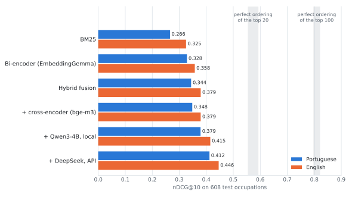
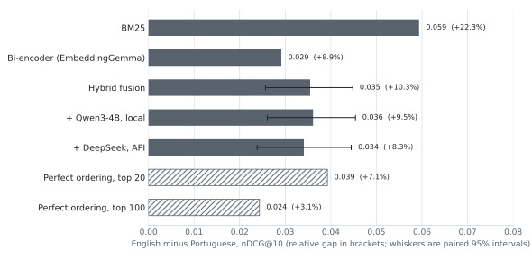

# esco-skill-linker

Mapping free-text learning outcomes and course descriptions to concepts in the
[ESCO](https://esco.ec.europa.eu/) skills pillar, with a reproducible benchmark for measuring
how well different retrieval approaches do it.

Portuguese-focused, evaluated against English as the comparison language.

> **Status:** method comparison complete. Benchmark frozen; lexical, dense, fusion,
> cross-encoder and LLM reranking scored across sixteen experiments. Four planned slices are
> not yet run; see [Future work](#future-work). Full findings in
> [`results/README.md`](results/README.md).

## Results so far

Portuguese retrieves worse than English, and the reason is not what the averages suggest.

Under lexical retrieval the two languages place a correct skill at the same median rank. The
[22%](results/bm25_stopwords.md "from bm25_stopwords.md") aggregate gap is produced by the worst 5 to 10% of queries, where the occupation
description and its gold skills use different Portuguese words for the same thing. A punch
press is a *puncionadora* in one record and a *prensa biela-manivela* in the other, so they
share no tokens at all and the best gold skill falls to rank [478](results/score_distribution.md "from score_distribution.md"). English says "punch press" on
both sides and retrieves it at rank [2](results/score_distribution.md "from score_distribution.md"). The effect is severe where it occurs and rare enough to
leave no trace in aggregate vocabulary overlap, which is why several averaged measurements
found nothing.

That diagnosis made a prediction, recorded before the dense retrieval runs: embeddings do not
need *cabedal* and *couro* to be the same string, so they should compress the Portuguese tail
rather than lift the median. They did. The Portuguese failure rate falls from [25.2%](results/dense_vs_lexical.md "from dense_vs_lexical.md") to [15.3%](results/dense_vs_lexical.md "from dense_vs_lexical.md"),
the top of the distribution barely moves, and per-query gains concentrate in exactly the
queries where lexical matching failed.

[608](results/split_profile.md "from split_profile.md") held-out occupation descriptions against all [13,939](results/dataset_profile.md "from dataset_profile.md") skills:

<picture>
  <source media="(prefers-color-scheme: dark)" srcset="results/figures/systems_dark.svg">
  
</picture>

| method | English | Portuguese | gap | gap, relative |
|---|---:|---:|---:|---:|
| BM25, stemmed, stopwords removed | [0.325](results/bm25_stopwords.md "from bm25_stopwords.md") | [0.266](results/bm25_stopwords.md "from bm25_stopwords.md") | [0.059](results/bm25_stopwords.md "from bm25_stopwords.md") | [+22.3%](results/bm25_stopwords.md "from bm25_stopwords.md") |
| Bi-encoder, EmbeddingGemma-300M | [0.358](results/bi_encoder.md "from bi_encoder.md") | [0.328](results/bi_encoder.md "from bi_encoder.md") | [0.029](results/bi_encoder.md "from bi_encoder.md") | [+8.9%](results/bi_encoder.md "from bi_encoder.md") |
| Hybrid, weighted score fusion | [0.379](results/rerank.md "from rerank.md") | [0.344](results/rerank.md "from rerank.md") | [0.035](results/rerank.md "from rerank.md") | [+10.3%](results/rerank.md "from rerank.md") |
| Hybrid, reranked by Qwen3-4B (local) | [0.415](results/llm_rerank_qwen3-4b-local.md "from llm_rerank_qwen3-4b-local.md") | [0.379](results/llm_rerank_qwen3-4b-local.md "from llm_rerank_qwen3-4b-local.md") | [0.036](results/llm_rerank_qwen3-4b-local.md "from llm_rerank_qwen3-4b-local.md") | [+9.5%](results/llm_rerank_qwen3-4b-local.md "from llm_rerank_qwen3-4b-local.md") |
| **Hybrid, reranked by DeepSeek (API)** | **[0.446](results/llm_rerank_deepseek.md "from llm_rerank_deepseek.md")** | **[0.412](results/llm_rerank_deepseek.md "from llm_rerank_deepseek.md")** | [0.034](results/llm_rerank_deepseek.md "from llm_rerank_deepseek.md") | [+8.3%](results/llm_rerank_deepseek.md "from llm_rerank_deepseek.md") |

nDCG@10. The gap is English minus Portuguese. Both columns matter: a relative gap shrinks
whenever both languages improve, even if the distance between them stays the same.

Dense retrieval removes about half of the language gap ([51%](results/bi_encoder.md "from bi_encoder.md, bm25_stopwords.md") in absolute terms, [60%](results/bi_encoder.md "from bi_encoder.md, bm25_stopwords.md") as a
relative gap), and does so asymmetrically: Portuguese gains [23.5%](results/bi_encoder.md "from bi_encoder.md, bm25_stopwords.md") where English gains [10.0%](results/bi_encoder.md "from bi_encoder.md, bm25_stopwords.md"). A study reporting only the English figure
would have called that a modest [10%](results/bi_encoder.md "from bi_encoder.md, bm25_stopwords.md") improvement and missed what it was doing.

Combining lexical with dense retrieval adds another [6%](results/rerank.md "from rerank.md, bi_encoder.md") in English and [5%](results/rerank.md "from rerank.md, bi_encoder.md") in Portuguese on top.
Read off the means, that widens the language gap again, from [0.029](results/bi_encoder.md "from bi_encoder.md") to [0.035](results/rerank.md "from rerank.md"), and an earlier
version of this README concluded that the best-performing system is not the most
language-equitable one. Paired on occupation, the change is [+0.006](results/llm_compare.md "from llm_compare.md") [[−0.001](results/llm_compare.md "from llm_compare.md"), [+0.014](results/llm_compare.md "from llm_compare.md")],
not distinguishable from zero, so that conclusion rested on point estimates. No stage after
dense retrieval measurably moves the gap in either direction.

After fusion the bottleneck moved to ordering. A flawless reranker over the same top-100
candidates would reach [0.797](results/rerank.md "from rerank.md") in Portuguese and [0.821](results/rerank.md "from rerank.md") in English, more than double the best
first stage, and a correct skill already sits in the top 10 for roughly [91%](results/rerank.md "from rerank.md") of Portuguese queries and [93%](results/rerank.md "from rerank.md") of English ones. Two
off-the-shelf multilingual cross-encoders captured none of that headroom. Both separate correct
from incorrect candidates well above chance and reproduce [82%](results/rerank.md "from rerank.md, rerank_qwen3-0.6b.md") to [103%](results/rerank.md "from rerank.md, rerank_qwen3-0.6b.md") of the first stage's
ordering quality, so they work, but they never improve on it, while adding [20](results/rerank.md "from rerank.md, rerank_qwen3-0.6b.md") to [142](results/rerank.md "from rerank.md, rerank_qwen3-0.6b.md") ms per
query on top of the first stage.

Listwise LLM reranking does improve on it. The model sees the description and all 20 top
candidates in one prompt and picks the best 10, so it can compare candidates against each
other, which a cross-encoder scoring one pair at a time cannot. A control shows that is only
part of why it helps. `Qwen3-Reranker-4B`, a pointwise reranker on the same base as the local
listwise model, also beats the first stage in both languages. It shows no measurable advantage
for the listwise format in English, though the interval allows listwise up to about [22%](results/llm_compare.md "from llm_compare.md, llm_rerank_qwen3-4b-local.md, rerank.md") of its
gain there, and keeps [73%](results/rerank.md "from rerank.md, llm_rerank_qwen3-4b-local.md") of the listwise gain in Portuguese. Model size explains most of the
difference from the smaller cross-encoders. The listwise format adds a measurable amount in
Portuguese; whether it helps Portuguese more than English is not established. A local Qwen3-4B adds about [10%](results/llm_rerank_qwen3-4b-local.md "from llm_rerank_qwen3-4b-local.md, rerank.md")
in both languages. DeepSeek's API model (`deepseek-flash`) adds [18%](results/llm_rerank_deepseek.md "from llm_rerank_deepseek.md, rerank.md") to [20%](results/llm_rerank_deepseek.md "from llm_rerank_deepseek.md, rerank.md"), beats the local
model on the same queries by about [0.03](results/llm_compare.md "from llm_compare.md") nDCG@10 in both languages, and captures about a third
of the headroom available at that depth against the local model's sixth. The whole experiment,
about [2,000](results/split_profile.md "from split_profile.md") reranked descriptions, cost $[0.37](results/figure_sources.md#deepseek.cost_usd "recorded in figure_sources.md") and ran more than ten times faster than the local
model on a laptop GPU. Paying bought quality as well as speed. What the local model offers in
return is reproducibility: it gave identical scores on a rerun, where the API moved by up to
[0.0015](results/llm_rerank_deepseek.md "from llm_rerank_deepseek.md").

No reranker narrowed the language gap. English leads by about [0.035](results/rerank.md "from rerank.md") nDCG@10 before reranking
and after either model, and the paired intervals on the change all include zero. The oracle
predicts this: at a depth of 20 even perfect ordering would leave the gap as it is. Perfect
ordering of the full top 100 may remove up to about half of it, but that effect is not
distinguishable from zero on this split ([31%](results/llm_compare.md "from llm_compare.md"), [[−3%](results/llm_compare.md "from llm_compare.md"), [56%](results/llm_compare.md "from llm_compare.md")]). An earlier version
of this README said most of the remaining gap was an ordering problem. That came from comparing
relative gaps at very different score levels, and the absolute figures do not support it.

<picture>
  <source media="(prefers-color-scheme: dark)" srcset="results/figures/language_gap_dark.svg">
  
</picture>

Three results worth noting alongside. A [308](results/figure_sources.md#model.embeddinggemma.params_m "recorded in figure_sources.md")M model beat a [4](results/figure_sources.md#model.qwen3emb.params_b "recorded in figure_sources.md")B one in both languages, and
`multilingual-e5-base` lost to BM25 in both, so the checkpoint matters more than the
architecture. Absent stopword handling turned out to cost Portuguese about a quarter of the
lexical gap, which was a flaw in this repository rather than in the data. And reciprocal rank
fusion, usually presented as the safe parameter-free default, failed to beat its own inputs in
[four](results/fusion.md "from fusion.md") of [five](results/fusion.md "from fusion.md") combinations at its conventional constant, while weighted fusion with a dev-tuned weight
succeeded in all [five](results/fusion.md "from fusion.md"). That comparison was tuned against untuned. Given the same dev tuning, RRF
beats its inputs in [four](results/fusion_rrf_tuned.md "from fusion_rrf_tuned.md") of [five](results/fusion.md "from fusion.md"), so the default failed rather than the method, though weighted
fusion still scores significantly higher for the hybrid used here.

Full analysis in [`results/README.md`](results/README.md).

## The problem

Course units are described in prose: learning outcomes, syllabus text, competence statements.
Labour market systems speak ESCO. Linking the two makes course content legible to employers,
comparable across institutions, and usable for guidance and matching.

The retrieval task: given a short free-text learning outcome, return the ESCO skill and
knowledge concepts it corresponds to, from a candidate space of [13,939](results/dataset_profile.md "from dataset_profile.md") concepts.

## The central question

The project started from an asymmetry in the data. ESCO's **descriptions are complete in both
languages**: [100%](results/dataset_profile.md "from dataset_profile.md") of skills and occupations carry one in Portuguese and in English. ESCO's
**alternative labels are not**: English skills carry [86,454](results/dataset_profile.md "from dataset_profile.md") alt-labels, Portuguese skills carry
[3,632](results/dataset_profile.md "from dataset_profile.md"), a **[23.8](results/dataset_profile.md "from dataset_profile.md")x gap**. The original question was whether dense retrieval could compensate for
that deficit in lexical surface forms.

Measurement narrowed it. The label deficit is worth about a fifth of English's lexical quality
when retrieval runs over labels alone, and Portuguese cannot access any of it. But on
description-only retrieval, where both languages have complete and comparable coverage,
English still leads. That residual is not caused by missing text, and it survives stopword
correction and parameter tuning. It comes from a minority of queries where the two records use
different words for the same concept, which a string-matching method cannot bridge.

So the question became:

> **How much of a vocabulary mismatch penalty does multilingual dense retrieval remove?**

Answered in [experiments 10 and 11](results/README.md): about half of it, and by compressing
the tail of failing queries rather than by improving retrieval generally. That is a concrete
argument for dense methods wherever a classification has been translated rather than authored
in the target language, which is the situation for 27 of ESCO's 28 languages. The rest of the
gap survives every later method, including both LLM rerankers, and remains unexplained.

A second question follows from the deployment setting. Because course documentation exists in
both languages, the practical question is not which language is better but whether using both
beats using either.

## Prior art

**This is not an unsolved problem, and this project does not claim to be novel in framing.**
The European Commission has run a three-phase pilot on exactly this task since 2019:
*Linking learning outcomes of qualifications with ESCO skills*.

| | Phase 2 (2020 to 2021) | Phase 3 (2022 to 2023) |
|---|---|---|
| Qualifications | [367](results/figure_sources.md#pilot.p2.qualifications "recorded in figure_sources.md"), [9](results/figure_sources.md#pilot.p2.languages "recorded in figure_sources.md") languages | [443](results/figure_sources.md#pilot.p3.mapped "recorded in figure_sources.md") mapped of [1038](results/figure_sources.md#pilot.p3.qualifications "recorded in figure_sources.md"), [12](results/figure_sources.md#pilot.p3.languages "recorded in figure_sources.md") languages |
| Selected concept ranked 1st | [30%](results/figure_sources.md#pilot.p2.top1 "recorded in figure_sources.md") | [44.65%](results/figure_sources.md#pilot.p3.top1 "recorded in figure_sources.md") |
| In top 3 | [48%](results/figure_sources.md#pilot.p2.top3 "recorded in figure_sources.md") | [63.98%](results/figure_sources.md#pilot.p3.top3 "recorded in figure_sources.md") |
| In top 5 | [56%](results/figure_sources.md#pilot.p2.top5 "recorded in figure_sources.md") | [70.35%](results/figure_sources.md#pilot.p3.top5 "recorded in figure_sources.md") |
| In top 10 | [66%](results/figure_sources.md#pilot.p2.top10 "recorded in figure_sources.md") | not reported |

Phase 3 covered DE, EL, ES, EN, FR, IT, LV, NL, PL, **PT**, SE and SI, produced [8,499](results/figure_sources.md#pilot.p3.outcomes "recorded in figure_sources.md") mapped
learning outcomes generating [29,894](results/figure_sources.md#pilot.p3.links "recorded in figure_sources.md") links, and compared three matching algorithms: a
word2vec-based model, a multilingual Sentence-BERT model operating in the native language,
and an English-only embedding model behind a translation step.

Sources:
[phase 1 note](https://esco.ec.europa.eu/system/files/2021-07/6a848118-4ea7-4577-8047-1e5ca0b01c98ESCO_MSWG_11-3_Initial_results_from_the_pilot_linking_Learning_Outcomes_of_qualifications_with_ESCO_skills.pdf) ·
[phase 2 report](https://esco.ec.europa.eu/system/files/2021-07/MSWG%2014-03%20Results%20of%20the%20second%20phase%20of%20the%20pilot%20project%20for%20linking%20learning%20outcomes%20of%20qualifications%20with%20ESCO%20skills%20and%20next%20steps.pdf) ·
[phase 3 report](https://esco.ec.europa.eu/system/files/2023-04/ESCO%20MSWG15032023_Results%20for%20the%20third%20phase%20of%20the%20pilot%20project%20for%20linking%20learning%20outcomes%20.pdf) ·
[ESCOpedia overview](https://esco.ec.europa.eu/en/about-esco/escopedia/escopedia/linking-learning-outcomes-qualifications-esco-skills)

### What this project adds

Two gaps in the published record:

1. **No per-language results were published.** Testing algorithm performance across EU
   languages was an explicit objective of phase 3, but the published note reports only pooled
   figures across all 12 languages, and does not state which of the three candidate algorithms
   performed best. Portuguese qualifications were mapped, since PT is in the language list and
   the University of Lusófona was among the seven participating training providers, yet no
   Portuguese number was released.

2. **The gold labels are conditioned on the system being evaluated.** The reported metric is
   how often a concept *selected by a human reviewer* appeared in the tool's top-k
   suggestions. Reviewers selected from the tool's own ranked list, so the ranking partly
   caused the labels it is scored against. This inflates the figures by an unknown amount and
   makes cross-system comparison difficult.

This project is an independent, reproducible, Portuguese-focused study: gold labels derived
from ESCO's own curated relations rather than from any system's output, a frozen test split,
and per-language numbers reported separately.

### Findings from the pilot reports that constrain the design

- Learning outcomes average **10 to 15 words**, so queries are short rather than document-length.
- Both phases converged on **1 to 3 ESCO concepts per learning outcome** as the expected
  mapping density.
- Only around [26%](results/figure_sources.md#pilot.p3.exact_share "recorded in figure_sources.md") of phase 3 links were exact matches; *close match* dominated, meaning the
  chosen concept typically does not fully cover the learning outcome's scope.
- Linking worked **better for VET than for higher education**, and ESCO was judged granular
  enough that some level of abstraction is needed at EQF 5 to 7. University course units are
  the harder case.
- Linking performed best in the native language, rather than via translation into English.
- Language-proficiency skills were called out as a weak spot, which is why ESCO's
  language-skill concepts are treated as their own slice.

## Scope

**In:** the ESCO skills pillar, including knowledge concepts. A course unit teaches a body of
knowledge at least as often as an applied competence, so excluding knowledge concepts would
misrepresent the task.

**Preferred input granularity:** individual learning outcome statements rather than whole
course descriptions. Cleaner retrieval problem, matches the European Learning Model structure,
and matches how the Commission's pilot framed it.

**Languages:** Portuguese and English. The loader takes a language list as a parameter, so
adding a third is configuration rather than a rewrite.

Course documentation at the target institution is authored in both languages, including the
learning outcomes themselves. A deployed system therefore has both texts for every course unit,
which is why the language comparison is treated as a design choice rather than as a constraint,
and why bilingual fusion is one of the approaches compared.

**Out:** the qualifications pillar. Three reasons:

1. ESCO is structured as **two** pillars, occupations and skills. Qualifications data lives
   in Europass. The portal's classification search offers only occupations and
   skills/competences.
2. Portugal's *Catálogo Nacional de Qualificações* is explicitly **non-tertiary** (levels 2, 4 and 5). It does not cover university degrees, which is the use case here.
3. ESCO's qualifications page states in the future tense that Europass *should* eventually
   display ESCO skills for qualifications. The per-learning-outcome skill links are therefore
   not publicly harvestable at scale today.

Worth revisiting if Europass exposes those links. The Portuguese CNQ revision completing in
March 2026 reorganises the catalogue around learning outcomes, which would be the right shape
if the ESCO links become available.

## Dataset

ESCO v1.2.1, classification release, CSV distribution, `pt` and `en`. All figures below are
measured by `src/ingest/build.py` and recorded in
[`results/dataset_profile.md`](results/dataset_profile.md).

### Concepts

| | Count |
|---|---|
| Skills (all `KnowledgeSkillCompetence`, all `released`) | [13,939](results/dataset_profile.md "from dataset_profile.md") |
| of which skill/competence | [10,715](results/dataset_profile.md "from dataset_profile.md") |
| of which knowledge | [3,219](results/dataset_profile.md "from dataset_profile.md") |
| of which unlabelled | [5](results/dataset_profile.md "from dataset_profile.md") |
| Occupations (all `released`) | [3,039](results/dataset_profile.md "from dataset_profile.md") |

Reusability level: sector-specific [6,655](results/dataset_profile.md "from dataset_profile.md") · cross-sector [3,783](results/dataset_profile.md "from dataset_profile.md") · occupation-specific [3,044](results/dataset_profile.md "from dataset_profile.md") ·
transversal [452](results/dataset_profile.md "from dataset_profile.md") · blank [5](results/dataset_profile.md "from dataset_profile.md").

The [5](results/dataset_profile.md "from dataset_profile.md") concepts with no `skillType` or `reuseLevel` are the DigComp competence areas
(*segurança TIC*, *criação de conteúdos digitais*, and three others), container concepts from a
framework layered onto ESCO. They are real concepts, kept in the index, and are not expected to
appear as gold.

### Text availability

| Field | PT skills | EN skills |
|---|---|---|
| `description` | [13,939](results/dataset_profile.md "from dataset_profile.md") ([100%](results/dataset_profile.md "from dataset_profile.md")) | [13,939](results/dataset_profile.md "from dataset_profile.md") ([100%](results/dataset_profile.md "from dataset_profile.md")) |
| `altLabels`, concepts covered | [1,126](results/dataset_profile.md "from dataset_profile.md") ([8.1%](results/dataset_profile.md "from dataset_profile.md")) | [13,921](results/dataset_profile.md "from dataset_profile.md") ([99.9%](results/dataset_profile.md "from dataset_profile.md")) |
| `altLabels`, total labels | [3,632](results/dataset_profile.md "from dataset_profile.md") | **[86,454](results/dataset_profile.md "from dataset_profile.md")** |
| `definition` | [0](results/dataset_profile.md "from dataset_profile.md") | [2](results/dataset_profile.md "from dataset_profile.md") |
| `scopeNote` | [0](results/dataset_profile.md "from dataset_profile.md") | [235](results/dataset_profile.md "from dataset_profile.md") |

`definition` and `scopeNote` are not used. Only English has them, so including them would add
another English-only advantage.

**The asymmetry is concentrated on the corpus side.** Occupations, which supply the queries,
carry [8,924](results/dataset_profile.md "from dataset_profile.md") Portuguese alt-labels against [30,387](results/dataset_profile.md "from dataset_profile.md") English, a [3.4](results/dataset_profile.md "from dataset_profile.md")x gap, much of it gendered pairs
(*Diretor técnico / Diretora técnica*). Skills, the retrieval corpus, differ by [23.8](results/dataset_profile.md "from dataset_profile.md")x.
Portuguese queries are therefore only mildly disadvantaged while the documents being searched
are severely so, which is where a lexical method needs surface forms to match against.

Every concept carries a preferred label in both languages: [13,939](results/dataset_profile.md "from dataset_profile.md") skills and [3,039](results/dataset_profile.md "from dataset_profile.md")
occupations, with no gaps on either side. Any Portuguese to English performance gap is
therefore a genuine effect rather than an artefact of missing labels.

### Ground truth

[126,051](results/dataset_profile.md "from dataset_profile.md") occupation to skill relations, identical across both language distributions. These
correspond to the ESCO model properties `relatedEssentialSkill` and `relatedOptionalSkill`.

| | Count |
|---|---|
| `essential` | [67,600](results/dataset_profile.md "from dataset_profile.md") |
| `optional` | [58,451](results/dataset_profile.md "from dataset_profile.md") |
| Occupations with ≥1 essential skill | [3,039](results/dataset_profile.md "from dataset_profile.md") of [3,039](results/dataset_profile.md "from dataset_profile.md") ([100%](results/dataset_profile.md "from dataset_profile.md")) |
| Distinct skills appearing as gold | [11,378](results/dataset_profile.md "from dataset_profile.md") of [13,939](results/dataset_profile.md "from dataset_profile.md") ([81.6%](results/dataset_profile.md "from dataset_profile.md")) |
| Skills never appearing as gold | [2,561](results/dataset_profile.md "from dataset_profile.md") |

Essential skills per occupation: mean [22.2](results/dataset_profile.md "from dataset_profile.md"), median [19](results/dataset_profile.md "from dataset_profile.md"), min [3](results/dataset_profile.md "from dataset_profile.md"), max [99](results/dataset_profile.md "from dataset_profile.md").

All [13,939](results/dataset_profile.md "from dataset_profile.md") skills stay in the retrieval index. The [2,561](results/dataset_profile.md "from dataset_profile.md") that never appear as gold serve as
distractors, which is the realistic setting and a stricter one than indexing only
gold-eligible concepts.

### Known defects in the release

**Concepts are exported more than once.** [21](results/dataset_profile.md "from dataset_profile.md") skills and [4](results/dataset_profile.md "from dataset_profile.md") occupations appear as two rows each,
differing only in `modifiedDate`; all other fields are identical. A loader that does not
deduplicate will carry [13,960](results/dataset_profile.md "from dataset_profile.md") skill rows for [13,939](results/dataset_profile.md "from dataset_profile.md") concepts and double-count the affected
queries. `src/ingest/build.py` collapses them and raises if a URI ever appears twice with
genuinely conflicting attributes.

**`occupationSkillRelations_<lang>.csv` carries English labels regardless of language.** The
`occupationLabel` and `skillLabel` columns hold English strings even in the `pt` distribution,
though the data dictionary declares both as `skos:prefLabel`. Only the URI columns are
language-correct. Joins must go through URIs and take labels from the concept files; using the
relation-file labels would silently produce an English benchmark labelled as Portuguese.

### Files used

Three per language: `skills_<lang>.csv`, `occupations_<lang>.csv`,
`occupationSkillRelations_<lang>.csv`.

The distribution ships [18](results/dataset_profile.md "from dataset_profile.md") files in Portuguese and [19](results/dataset_profile.md "from dataset_profile.md") in English. The collection files
(`transversalSkillsCollection`, `greenSkillsCollection`, `digitalSkillsCollection` and
similar) are redundant here because `reuseLevel` and `inScheme` on `skills` already encode
that membership. `broaderRelationsSkillPillar`, `skillGroups` and `skillsHierarchy` become
relevant only for the abstraction experiment, and `skillSkillRelations` only for query
expansion.

## Benchmark design

**Queries:** ESCO occupation descriptions.
**Relevant items:** the skills ESCO relates to that occupation.
**Splits:** at the occupation level. The test set is frozen and scored once per approach.

Gold labels come from ESCO's own curated relations, so they are independent of any retrieval
system's output.

### Graded relevance

An optional skill is genuinely related to the occupation, so scoring its retrieval as an error
would be wrong. The essential and optional distinction is kept as a grade:

| Relation | Grade |
|---|---|
| `essential` | 2 |
| `optional` | 1 |
| none | 0 |

nDCG@k uses the graded scale directly. precision@k, recall@k and MRR are reported on
**essential-only** as a binary set. Both readings come from a single run, and reporting them
side by side shows whether a method's advantage is real or comes from surfacing optional
skills.

### Metrics

precision@k, recall@k, MRR, nDCG@k.

The Commission's pilot reports top-k accuracy, the share of reviewer-selected concepts
appearing in the tool's top k. It is not reported here. A pilot learning outcome carries 1 to
3 concepts; an occupation here carries around [22](results/dataset_profile.md "from dataset_profile.md"), so the same share is capped far below
1 at small k (see the recall ceilings in [`results/README.md`](results/README.md)) and would
not be comparable with the pilot's figures even as a rough reference.

### Slices

- **Language:** Portuguese against English, the primary comparison.
- **Text field:** labels alone against labels plus description. The alternative-label
  asymmetry is confined to the labels, so splitting the fields separates the part of the gap
  caused by missing text from the part that is not.
- **Gold set size:** quartiles by number of essential skills, since the benchmark's query shape
  differs from the target application's.

The language slice is reported in every experiment, the text-field slice in experiments 01, 05
and 10, and gold set size in experiment 02, for BM25 only. Further slices were planned and
are listed under [Future work](#future-work).

### Cross-lingual evaluation

ESCO assigns a stable URI per concept across all languages. The same occupation queried in
Portuguese and in English has an identical gold set, so the per-language delta is measurable
directly, with no translation step and no annotation cost.

## Approaches compared

Each scored on the same frozen split, with latency and cost recorded alongside quality.

1. **BM25** over labels and descriptions, the floor any semantic method must clear
2. **Bi-encoder**, several multilingual checkpoints
3. **Hybrid** lexical and dense score fusion
4. **Bilingual fusion**, combining the Portuguese and English ranked lists for the same course unit
5. **Cross-encoder reranking** over a shortlist from the best first-stage method
6. **Listwise LLM reranking**, a local model against a paid API, on quality, latency and cost

Late interaction (ColBERT-style, one vector per token) was planned and dropped. The oracle in
experiment 14 shows the existing shortlist already supports nDCG@10 of about [0.81](results/rerank.md "from rerank.md"), so the
bottleneck is ordering, and a different retriever would not address it.

### Why bilingual fusion

Course documentation at the target institution is written in both Portuguese and English, so a
deployed system has both texts for the same course unit. That makes the language comparison a
design question rather than a constraint: which language should the system retrieve in, given
both exist?

ESCO assigns a stable URI per concept, so retrieval language and display language are
independent: a system can retrieve using the English text and present the Portuguese label for
the same concept.

The headroom is measured rather than assumed. Under the best bi-encoder, Portuguese fails on
[15.3%](results/residual_gap.md "from residual_gap.md") of queries and English on [12.3%](results/residual_gap.md "from residual_gap.md"), but only [9.0%](results/residual_gap.md "from residual_gap.md") fail in both. So [6.2%](results/residual_gap.md "from residual_gap.md") of occupations are
Portuguese-only failures that the English text could recover, and [3.3%](results/residual_gap.md "from residual_gap.md") the reverse. Per-query
scores correlate [0.825](results/residual_gap.md "from residual_gap.md") between the languages, so most failures are shared and fusion's ceiling
is modest. It is worth measuring because that ceiling is real, not because the languages are
independent.

Because per-query results are recorded per language against the same occupation URIs, fusion is
an analysis over existing runs rather than a separate retrieval pipeline.

## Limitations

- **Occupation to skill links describe work, not teaching.** Performance on this benchmark is
  a proxy for the course-documentation use case rather than a measurement of it.
- **Query shape differs from the target use case.** Test queries are occupation descriptions
  with a mean of [22.5](results/split_profile.md "from split_profile.md") essential skills each ([22.2](results/dataset_profile.md "from dataset_profile.md") across all occupations). Real learning
  outcomes run 10 to 15 words with 1 to 3 concepts. [Experiment 02](results/README.md) tests
  how far this matters by slicing results into gold-set-size quartiles, but only for one
  configuration: BM25 over labels and descriptions, stemmed, without stopword removal. For
  that configuration the Portuguese deficit holds in every quartile, and performance on the
  smallest bucket (median [12](results/gold_size_slice.md "from gold_size_slice.md") essential skills) matches the pooled figures. Whether dense
  retrieval, fusion and reranking behave the same way on small gold sets is untested, and so
  is query *length*, since every query here is a full occupation description.
- **Any lexical PT to EN gap is partly a corpus artefact.** With [23.8](results/dataset_profile.md "from dataset_profile.md")x fewer alternative labels
  on the skills being retrieved, a BM25 gap over labels measures ESCO's label coverage as well
  as the method. [Experiment 01](results/README.md) separates the two: adding alternative
  labels is worth about a fifth of English's quality and nothing measurable in Portuguese,
  while the gap on description-only retrieval, where coverage is equal, has a different cause
  entirely.
- **Recall is bounded well below 1.** With around [22](results/split_profile.md "from split_profile.md") gold skills per query, recall@10 cannot
  exceed [0.543](results/bm25.md "from bm25.md, split_profile.md") on this split. Absolute recall figures should be read against the ceilings
  reported alongside them.
- **Cross-language comparisons are partly confounded with preprocessing quality.** Both
  languages run through identical code and identical parameters, audited in
  [`results/README.md`](results/README.md), but identical treatment is not equal treatment.
  Absent stopword handling was found to cost Portuguese roughly a quarter of the measured gap
  and has been corrected. Snowball's two stemmers remain different algorithms, and the corpora
  differ enough in scale that BM25's length normalisation and negative-IDF floor may not behave
  equivalently. Neither has been ruled out.
- **The LLM rerankers may have seen the answers.** The gold labels are ESCO's own
  occupation-to-skill links, which are published on the web and likely in both models'
  training data. Part of the LLM gain could be recall of those links rather than judgement of
  relevance. Larger models memorise more, so this weighs more on DeepSeek's result than on
  Qwen's. The benchmark cannot separate the two.
- **The API model is a moving target.** `deepseek-chat` is an alias the provider repoints; the
  reported run was served by `deepseek-flash` on [9 November 2026](results/llm_rerank_deepseek.md "from llm_rerank_deepseek.md"). The API is also not
  deterministic at temperature 0: two identical runs differed by up to [0.0015](results/llm_rerank_deepseek.md "from llm_rerank_deepseek.md") nDCG@10, small
  against its [0.03](results/llm_compare.md "from llm_compare.md") lead over the local model, but enough that the figures cannot be reproduced
  exactly.

## Future work

Slices that are part of the benchmark design and not yet run:

- **Transversal:** with and without the [452](results/dataset_profile.md "from dataset_profile.md") transversal skills, which flood similarity-based
  rankings.
- **Concept type:** knowledge against skill/competence.
- **Sector:** via `iscoGroup` and `naceCode`, both fully populated on occupations.
- **Language skills:** reported separately, following the Commission's finding that proficiency
  levels are a known failure case.

The pointwise control in [experiment 15](results/README.md) separates the listwise format from
model size but not from training: the pointwise reranker and the listwise instruct model share
a base and were fine-tuned differently. Separating that would need a listwise and a pointwise
model fine-tuned the same way from the same base.

## Repository layout

```
src/ingest/      load and normalise the ESCO release
src/eval/        benchmark construction and metrics
src/retrieval/   one module per approach
src/linker.py    the selected pipeline, for one learning outcome at a time
experiments/     scripts producing rows in the results table
results/         committed output of every run
data/raw/        source release files (gitignored)
data/processed/  derived tables
```

Files under `results/` are version-controlled deliberately, so claims about improvement stay
checkable against the run that produced them.

## Setup

Python 3.12. Developed on a 12 GB RTX 5070 laptop GPU under WSL2.

```bash
python3 -m venv .venv
source .venv/bin/activate
pip install -r requirements.txt
python -c "import nltk; nltk.download('stopwords')"
```

Two parts need access set up beforehand:

- **Dense retrieval (10 onwards) uses EmbeddingGemma, a gated model.** Accept the Gemma terms
  on the [model page](https://huggingface.co/google/embeddinggemma-300m), then log in with a
  Hugging Face token: `hf auth login`.
- **The API arm of experiment 15 needs a DeepSeek key** in `DEEPSEEK_API_KEY`. The local arm
  needs no key, but at a shortlist depth of 20 it needs about 12 GB of GPU memory at batch
  size 4.

`requirements.txt` installs the default PyPI build of torch. The results were produced with the
CUDA 13.2 build; to match it, install torch from [pytorch.org](https://pytorch.org/) before the
requirements.

## Getting the data

The ESCO download portal requires registration, so ingest cannot run end-to-end from a clean
clone. The release is pinned and verifiable instead:

1. Register at the [ESCO download page](https://esco.ec.europa.eu/en/use-esco/download).
2. Select version **v1.2.1**, content **Classification**, format **csv**, and download once per
   language (`pt`, `en`).
3. Extract into `data/raw/pt/` and `data/raw/en/`.
4. Verify: `(cd data && sha256sum -c checksums.txt)`
5. Build the derived tables: `python -m src.ingest.build`

`data/checksums.txt` and `data/README.md` record the version, download date, and hash of every
source file.

## Try it

`src/linker.py` runs the selected system on one learning outcome at a time: BM25 and
EmbeddingGemma fused with the dev-tuned weight, optionally followed by LLM reranking of the top
20. It needs the data from the previous section.

```bash
python -m src.linker --lang pt "Aplicar técnicas de aprendizagem automática a dados de sensores"
python -m src.linker --lang en --rerank qwen3-4b-local
python -m src.linker --lang pt --rerank deepseek
```

The first of those, without reranking:

```
  Competências / Skills
    1. utilizar aprendizagem por máquina / utilise machine learning
    4. aplicar técnicas de análise estatística / apply statistical analysis techniques
    5. efetuar redução de dimensionalidade / perform dimensionality reduction
    6. testar sensores / test sensors
   10. fazer modelo de simulação de sensores / model sensor

  Conhecimentos / Knowledge
    2. ciência dos dados / data science
    3. aprendizagem automática / machine learning
    7. análise de dados / data mining
    8. tecnologia de gémeos digitais / digital twin technology
    9. leitura de contador automático / automatic meter reading
```

ESCO types each concept as a *skill* (*competência*), something a person does, or *knowledge*
(*conhecimento*), something a person knows, which maps onto how learning outcomes are usually
written. Results are grouped by type, each label shown in both languages, and each keeps its rank in
the full list.

Without a learning outcome it starts an interactive prompt, so the indexes and models load once
and each further query costs only its own retrieval. Every result shows the skill's label in
both languages, since an ESCO concept keeps one URI across all of them. The first run in each
language embeds all [13,939](results/dataset_profile.md "from dataset_profile.md") skills, which takes a minute or two on a GPU; later runs read the
cached embeddings.

## Design notes

- **Eval infrastructure comes before pipeline code.** Building the pipeline first invites weeks
  of tuning by intuition followed by a rewrite.
- **Every result is committed alongside the run that produced it**, so improvement claims stay
  checkable.
- **Metrics are reported per slice rather than pooled**, because a pooled average across
  languages is exactly what makes the existing published numbers hard to build on.
- **Language gaps are reported in absolute as well as relative terms.** A relative gap shrinks
  whenever both languages improve, so any claim that a method narrows the gap is checked against
  the absolute difference, per query, with a paired interval.
- **Numbers in the READMEs are generated.** The prose lives in `docs/templates/`, where every
  figure is a placeholder resolved by `experiments/figures.py` from the committed result files.
  [`results/figure_sources.md`](results/figure_sources.md) lists each figure's value and source.
  Regenerate with `python -m experiments.render_docs`; add `--check` to fail on a stale README or
  a hand-typed number in a template.

## Related work by the author

A 2024 version of this system was built as master's thesis work:
[esco-skills-matcher-api](https://github.com/Toja-Ferreira/esco-skills-matcher-api). KeyBERT
keywords plus Sentence-Transformers embeddings with optional KMeans clustering, merged into a
shortlist, reranked by an LLM, validated against ESCO. It was evaluated by asking academic
staff to rate outputs from three candidate pipelines, which was informative but not
reproducible.

That system reranked with DeepSeek. Experiment 15 measures that choice against a benchmark for
the first time: listwise LLM reranking is the only reranking method here that improves on the
first stage.

This repository is a clean rebuild against public data with an automatic benchmark. No code
carried over, no university data used.

## Licence

ESCO is published by the European Commission under its own terms of use; see the
[ESCO portal](https://esco.ec.europa.eu/) for details. Check those terms before redistributing
derived data.