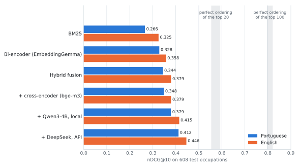
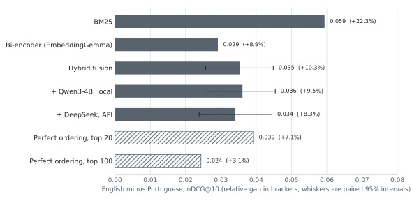

# Results

Findings across experiments. Each entry interprets numbers held in a generated
file alongside it. Generated files are overwritten on every run; this one is
not.

| # | experiment | generated output | script |
|---|---|---|---|
| 01 | BM25 lexical baseline | [`bm25.md`](bm25.md) | [`experiments/01_bm25.py`](../experiments/01_bm25.py) |
| 02 | Quality by gold set size | [`gold_size_slice.md`](gold_size_slice.md) | [`experiments/02_gold_size_slice.py`](../experiments/02_gold_size_slice.py) |
| 03 | Lexical overlap, query to gold | [`lexical_overlap.md`](lexical_overlap.md) | [`experiments/03_lexical_overlap.py`](../experiments/03_lexical_overlap.py) |
| 04 | IDF-weighted overlap | [`weighted_overlap.md`](weighted_overlap.md) | [`experiments/04_weighted_overlap.py`](../experiments/04_weighted_overlap.py) |
| 05 | BM25 with stopword removal | [`bm25_stopwords.md`](bm25_stopwords.md) | [`experiments/05_stopwords.py`](../experiments/05_stopwords.py) |
| 06 | Parameter sweep, dev tuned | [`bm25_sweep.md`](bm25_sweep.md) | [`experiments/06_bm25_sweep.py`](../experiments/06_bm25_sweep.py) |
| 07 | Score distribution, gold against field | [`score_distribution.md`](score_distribution.md) | [`experiments/07_score_distribution.py`](../experiments/07_score_distribution.py) |
| 08 | Failure cases, read directly | [`failure_cases.md`](failure_cases.md) | [`experiments/08_failure_cases.py`](../experiments/08_failure_cases.py) |
| 09 | Overlap by term rarity | [`idf_band_overlap.md`](idf_band_overlap.md) | [`experiments/09_idf_band_overlap.py`](../experiments/09_idf_band_overlap.py) |
| 10 | Bi-encoder retrieval | [`bi_encoder.md`](bi_encoder.md) | [`experiments/10_bi_encoder.py`](../experiments/10_bi_encoder.py) |
| 11 | Dense against lexical, per query | [`dense_vs_lexical.md`](dense_vs_lexical.md) | [`experiments/11_dense_vs_lexical.py`](../experiments/11_dense_vs_lexical.py) |
| 12 | Shape of the residual language gap | [`residual_gap.md`](residual_gap.md) | [`experiments/12_residual_gap.py`](../experiments/12_residual_gap.py) |
| 13 | Hybrid and bilingual fusion | [`fusion.md`](fusion.md) | [`experiments/13_fusion.py`](../experiments/13_fusion.py) |
| 14 | Cross-encoder reranking, and the ordering ceiling | [`rerank.md`](rerank.md), [`rerank_qwen3-0.6b.md`](rerank_qwen3-0.6b.md) | [`experiments/14_rerank.py`](../experiments/14_rerank.py) |
| 15 | Listwise LLM reranking, local and API | [`llm_rerank_qwen3-4b-local.md`](llm_rerank_qwen3-4b-local.md), [`llm_rerank_deepseek.md`](llm_rerank_deepseek.md) | [`experiments/15_llm_rerank.py`](../experiments/15_llm_rerank.py) |
| 16 | Local against API, per query | [`llm_compare.md`](llm_compare.md) | [`experiments/16_llm_compare.py`](../experiments/16_llm_compare.py) |

Figures in [`figures/`](figures/) are drawn from these result files by
[`experiments/make_figures.py`](../experiments/make_figures.py).
Every number in this file is rendered from them too;
[`figure_sources.md`](figure_sources.md) gives the source of each.

Also here: [`dataset_profile.md`](dataset_profile.md) and
[`split_profile.md`](split_profile.md), describing the release and the frozen
evaluation split.

## Current best

[608](split_profile.md "from split_profile.md") held-out occupation descriptions against all [13,939](dataset_profile.md "from dataset_profile.md") skills, nDCG@10.

Experiment 14 measures what a flawless reranker would reach over the same
top-100 candidates: **[0.797](rerank.md "from rerank.md") Portuguese and [0.821](rerank.md "from rerank.md") English**, more than double
the best first stage. The shortlist already contains a correct skill in its top
10 for roughly [91%](rerank.md "from rerank.md") of Portuguese queries and [93%](rerank.md "from rerank.md") of English ones, so most of what is missing is ordering.

<picture>
  <source media="(prefers-color-scheme: dark)" srcset="figures/systems_dark.svg">
  
</picture>

| system | English | Portuguese | gap | gap, relative |
|---|---:|---:|---:|---:|
| BM25, stemmed, stopwords removed | [0.3252](bm25_stopwords.md "from bm25_stopwords.md") | [0.2658](bm25_stopwords.md "from bm25_stopwords.md") | [0.0594](bm25_stopwords.md "from bm25_stopwords.md") | [+22.3%](bm25_stopwords.md "from bm25_stopwords.md") |
| Bi-encoder, `embeddinggemma-300m` | [0.3576](bi_encoder.md "from bi_encoder.md") | [0.3284](bi_encoder.md "from bi_encoder.md") | [0.0291](bi_encoder.md "from bi_encoder.md") | [+8.9%](bi_encoder.md "from bi_encoder.md") |
| Hybrid, weighted score fusion | [0.3794](rerank.md "from rerank.md") | [0.3439](rerank.md "from rerank.md") | [0.0355](rerank.md "from rerank.md") | [+10.3%](rerank.md "from rerank.md") |
| Hybrid, reranked by Qwen3-4B (local) | [0.4149](llm_rerank_qwen3-4b-local.md "from llm_rerank_qwen3-4b-local.md") | [0.3788](llm_rerank_qwen3-4b-local.md "from llm_rerank_qwen3-4b-local.md") | [0.0361](llm_rerank_qwen3-4b-local.md "from llm_rerank_qwen3-4b-local.md") | [+9.5%](llm_rerank_qwen3-4b-local.md "from llm_rerank_qwen3-4b-local.md") |
| **Hybrid, reranked by DeepSeek (API)** | **[0.4460](llm_rerank_deepseek.md "from llm_rerank_deepseek.md")** | **[0.4119](llm_rerank_deepseek.md "from llm_rerank_deepseek.md")** | [0.0341](llm_rerank_deepseek.md "from llm_rerank_deepseek.md") | [+8.3%](llm_rerank_deepseek.md "from llm_rerank_deepseek.md") |

The best system is hybrid weighted score fusion followed by listwise reranking
of the top 20 with DeepSeek's API model, which costs about $[0.0002](split_profile.md "from split_profile.md") per
description. Where a paid API is not an option, the same reranking with a local
Qwen3-4B keeps about half the gain at no per-query cost and reproduces exactly.
Without an LLM, the recommended configuration is hybrid fusion in one language.
Fusing all four runs, both methods in both languages, scores marginally higher
at [0.3817](fusion.md "from fusion.md") but is not distinguishable from it (paired difference [+0.0023](fusion.md "from fusion.md")
[[−0.0010](fusion.md "from fusion.md"), [+0.0056](fusion.md "from fusion.md")]), so the simpler system is preferred.

Recall@10 is capped at [0.543](bm25.md "from bm25.md, split_profile.md") on this split, so the English hybrid's [0.155](rerank.md "from rerank.md") is [29%](rerank.md "from rerank.md, bm25.md, split_profile.md") of
what is reachable.

What the headline table does not show: dense retrieval closed about half of the
lexical language gap by compressing a tail of failing Portuguese queries, and
nothing after it, fusion or either reranker, measurably moved the gap again.

---

## Reading the numbers

**Recall@k is capped well below 1.** Occupations carry around [22](split_profile.md "from split_profile.md") essential
skills on average and only 10 fit in a top-10, so the highest recall@10
achievable on this split is **[0.543](bm25.md "from bm25.md, split_profile.md")**. EmbeddingGemma's English recall@10 of [0.145](bi_encoder.md "from bi_encoder.md") is [27%](bi_encoder.md "from bi_encoder.md, bm25.md, split_profile.md") of what is
reachable.

| k | 1 | 3 | 5 | 10 | 20 | 50 |
|---|---:|---:|---:|---:|---:|---:|
| max recall@k | [0.056](bm25.md "from bm25.md, split_profile.md") | [0.167](bm25.md "from bm25.md, split_profile.md") | [0.278](bm25.md "from bm25.md, split_profile.md") | [0.543](bm25.md "from bm25.md, split_profile.md") | [0.856](bm25.md "from bm25.md, split_profile.md") | [0.993](bm25.md "from bm25.md, split_profile.md") |

**Arrows and bold.** ▲ and ▼ mark a change in retrieval quality against the
baseline the table names. Where a paired interval is given, the arrow appears
only when the interval excludes zero, so a change with no arrow is not
distinguishable from noise. Language gaps carry no arrow. Bold marks the best
value in a comparison.

**Precision and MRR answer different questions.** The best English run, DeepSeek reranking, has P@10
of [0.345](llm_rerank_deepseek.md "from llm_rerank_deepseek.md"), so most of what it shows is wrong, alongside MRR of [0.768](llm_rerank_deepseek.md "from llm_rerank_deepseek.md"), meaning the
first genuinely essential skill usually appears at rank 1 or 2 out of [13,939](dataset_profile.md "from dataset_profile.md")
candidates. Retrieval finds one correct skill easily and the full set poorly,
and which of those matters depends on the interface.

---

## 01: BM25 lexical baseline

[608](split_profile.md "from split_profile.md") test occupations, full index, [16](bm25.md "from bm25.md") conditions covering 2 languages, 4 document
variants and stemmed against unstemmed. No stopword removal, which experiment 05
later revised.

### The alternative-label asymmetry behaves as predicted

Adding ESCO's alternative labels to the preferred label transforms the English
index and does nothing measurable for Portuguese:

| | preferred | plus alt labels | change | tokens/doc |
|---|---:|---:|---:|---|
| pt, raw | [0.163](bm25_stopwords.md "from bm25_stopwords.md") | [0.162](bm25_stopwords.md "from bm25_stopwords.md") | ▼ [−0.5%](bm25_stopwords.md "from bm25_stopwords.md") | [4.9](bm25_stopwords.md "from bm25_stopwords.md") to [6.1](bm25_stopwords.md "from bm25_stopwords.md") |
| en, raw | [0.189](bm25_stopwords.md "from bm25_stopwords.md") | [0.227](bm25_stopwords.md "from bm25_stopwords.md") | ▲ [+20.1%](bm25_stopwords.md "from bm25_stopwords.md") | [3.6](bm25_stopwords.md "from bm25_stopwords.md") to [29.3](bm25_stopwords.md "from bm25_stopwords.md") |

English documents grow eightfold. Portuguese documents grow by roughly one
token, because only [8%](dataset_profile.md "from dataset_profile.md") of Portuguese skills carry any alternative label. The
[23.8](dataset_profile.md "from dataset_profile.md")x label asymmetry recorded in the dataset profile is worth a fifth of
English lexical retrieval quality, and Portuguese cannot access any of it.

### The label gap does not account for the whole deficit

On document variants where ESCO treats both languages equally, Portuguese has
more text and still scores lower:

| condition | pt tokens | en tokens | pt nDCG@10 | en nDCG@10 | en advantage |
|---|---:|---:|---:|---:|---:|
| preferred, raw | [4.9](bm25_stopwords.md "from bm25_stopwords.md") | [3.6](bm25_stopwords.md "from bm25_stopwords.md") | [0.163](bm25_stopwords.md "from bm25_stopwords.md") | [0.189](bm25_stopwords.md "from bm25_stopwords.md") | [+15.8%](bm25_stopwords.md "from bm25_stopwords.md") |
| description, raw | [25.2](bm25_stopwords.md "from bm25_stopwords.md") | [22.2](bm25_stopwords.md "from bm25_stopwords.md") | [0.188](bm25_stopwords.md "from bm25_stopwords.md") | [0.230](bm25_stopwords.md "from bm25_stopwords.md") | [+22.4%](bm25_stopwords.md "from bm25_stopwords.md") |
| description, stemmed | [25.2](bm25_stopwords.md "from bm25_stopwords.md") | [22.2](bm25_stopwords.md "from bm25_stopwords.md") | [0.208](bm25_stopwords.md "from bm25_stopwords.md") | [0.258](bm25_stopwords.md "from bm25_stopwords.md") | [+24.3%](bm25_stopwords.md "from bm25_stopwords.md") |

Portuguese preferred labels are [36%](bm25_stopwords.md "from bm25_stopwords.md") longer than English ones and score [14%](bm25_stopwords.md "from bm25_stopwords.md")
lower. Descriptions are [14%](bm25_stopwords.md "from bm25_stopwords.md") longer and score [20%](bm25_stopwords.md "from bm25_stopwords.md") lower. Every interval is
disjoint. A shortage of text does not explain this, which rules out the original
framing of the project's central question. Experiments 03 to 05 pursue the
cause.

### Stemming helps, and helps English more on short fields

Relative nDCG@10 gain from stemming, before stopword removal:

| variant | pt | en |
|---|---:|---:|
| preferred | ▲ [+13.5%](bm25_stopwords.md "from bm25_stopwords.md") | ▲ [+23.3%](bm25_stopwords.md "from bm25_stopwords.md") |
| labels | ▲ [+13.5%](bm25_stopwords.md "from bm25_stopwords.md") | ▲ [+11.6%](bm25_stopwords.md "from bm25_stopwords.md") |
| labels_desc | ▲ [+6.9%](bm25_stopwords.md "from bm25_stopwords.md") | ▲ [+5.7%](bm25_stopwords.md "from bm25_stopwords.md") |
| description | ▲ [+10.6%](bm25_stopwords.md "from bm25_stopwords.md") | ▲ [+12.3%](bm25_stopwords.md "from bm25_stopwords.md") |

Portuguese is the more heavily inflected language, so the expectation was that it
would gain more. On `preferred`, where a single stem match carries most of the
signal, it gains roughly half as much.

That observation was initially recorded as an unexplained curiosity. It is
better read as a candidate explanation for the language gap itself: a stemmer
that under-conflates would both gain less from being applied and depress the
language's scores throughout. Experiment 03 tests it directly.

### Preprocessing audit

Every cross-language claim depends on the two languages receiving identical
treatment. Recorded so it can be checked rather than assumed. Package versions
are pinned in [`requirements.txt`](../requirements.txt).

| | Portuguese | English |
|---|---|---|
| Tokeniser | `re.findall(r"\w+", text.lower())`, `re.UNICODE` | identical |
| Accent handling | preserved, not folded | preserved, not folded |
| Stemmer, stemmed runs | Snowball `portuguese` | Snowball `english` |
| Stopword list, experiment 01 | none | none |
| Stopword list, experiment 05 | NLTK `portuguese` | NLTK `english` |
| BM25 implementation | `rank_bm25.BM25Okapi` | identical |
| k1 / b / epsilon | 1.5 / 0.75 / 0.25 (defaults) | 1.5 / 0.75 / 0.25 (defaults) |
| Index contents | all [13,939](dataset_profile.md "from dataset_profile.md") skills | all [13,939](dataset_profile.md "from dataset_profile.md") skills |
| Query text | occupation `description` | occupation `description` |

Parameters are never passed explicitly, so both languages take the same library
defaults. The tokeniser, stemmer and stopword list live on `BM25Index`, which
applies them to documents at construction and to queries at search time, so the
two cannot diverge.

Three asymmetries remain that configuration cannot remove:

1. **The stemmers are different algorithms.** Snowball's Portuguese and English
   stemmers were developed separately and there is no reason to assume equal
   conflation quality. Experiment 03 measures this directly.
2. **`b = 0.75` normalises against each corpus's own mean length**, so there is
   no shared baseline penalising the longer language. But the corpora differ in
   scale rather than by a constant: under `labels` the English mean is [29.3](bm25_stopwords.md "from bm25_stopwords.md")
   tokens against [6.1](bm25_stopwords.md "from bm25_stopwords.md") in Portuguese.
3. **`epsilon = 0.25` floors negative IDF values.** Terms appearing in more than
   half the corpus get a small positive score rather than a negative one. How
   often the floor is hit depends on term distribution, which differs between
   corpora. Not measured.

No parameter tuning has been done in either language.

### Cost

[26](bm25.md "from bm25.md") to [47](bm25.md "from bm25.md") ms per query, index build at most [7.1](bm25.md "from bm25.md") s, everything in memory. Any method
costing materially more should be judged on quality per unit latency.

---

## 02: Quality by gold set size

The benchmark queries occupations carrying a mean of [22](split_profile.md "from split_profile.md") essential skills. The
target application queries learning outcomes carrying 1 to 3. If method
behaviour shifts as gold sets shrink, the benchmark is a poor proxy. This slices
the recorded per-query results from experiment 01 into gold-size quartiles. No
retrieval is re-run.

| bucket | queries | essential skills | median | max recall@10 |
|---|---:|---|---:|---:|
| Q1 smallest | [159](gold_size_slice.md "from gold_size_slice.md") | [6](gold_size_slice.md "from gold_size_slice.md") to [14](gold_size_slice.md "from gold_size_slice.md") | [12](gold_size_slice.md "from gold_size_slice.md") | [0.861](gold_size_slice.md "from gold_size_slice.md") |
| Q2 | [163](gold_size_slice.md "from gold_size_slice.md") | [15](gold_size_slice.md "from gold_size_slice.md") to [20](gold_size_slice.md "from gold_size_slice.md") | [18](gold_size_slice.md "from gold_size_slice.md") | [0.577](gold_size_slice.md "from gold_size_slice.md") |
| Q3 | [139](gold_size_slice.md "from gold_size_slice.md") | [21](gold_size_slice.md "from gold_size_slice.md") to [27](gold_size_slice.md "from gold_size_slice.md") | [24](gold_size_slice.md "from gold_size_slice.md") | [0.419](gold_size_slice.md "from gold_size_slice.md") |
| Q4 largest | [147](gold_size_slice.md "from gold_size_slice.md") | [28](gold_size_slice.md "from gold_size_slice.md") to [74](gold_size_slice.md "from gold_size_slice.md") | [34](gold_size_slice.md "from gold_size_slice.md") | [0.279](gold_size_slice.md "from gold_size_slice.md") |

### The English advantage is uniform across gold set sizes

nDCG@10:

| bucket | pt | en | en advantage |
|---|---|---|---:|
| Q1 smallest | [0.237](gold_size_slice.md "from gold_size_slice.md") [[0.210](gold_size_slice.md "from gold_size_slice.md"), [0.265](gold_size_slice.md "from gold_size_slice.md")] | [0.308](gold_size_slice.md "from gold_size_slice.md") [[0.277](gold_size_slice.md "from gold_size_slice.md"), [0.339](gold_size_slice.md "from gold_size_slice.md")] | [+29.7%](gold_size_slice.md "from gold_size_slice.md") |
| Q2 | [0.247](gold_size_slice.md "from gold_size_slice.md") [[0.215](gold_size_slice.md "from gold_size_slice.md"), [0.278](gold_size_slice.md "from gold_size_slice.md")] | [0.310](gold_size_slice.md "from gold_size_slice.md") [[0.275](gold_size_slice.md "from gold_size_slice.md"), [0.344](gold_size_slice.md "from gold_size_slice.md")] | [+25.4%](gold_size_slice.md "from gold_size_slice.md") |
| Q3 | [0.224](gold_size_slice.md "from gold_size_slice.md") [[0.196](gold_size_slice.md "from gold_size_slice.md"), [0.254](gold_size_slice.md "from gold_size_slice.md")] | [0.289](gold_size_slice.md "from gold_size_slice.md") [[0.261](gold_size_slice.md "from gold_size_slice.md"), [0.318](gold_size_slice.md "from gold_size_slice.md")] | [+28.9%](gold_size_slice.md "from gold_size_slice.md") |
| Q4 largest | [0.281](gold_size_slice.md "from gold_size_slice.md") [[0.250](gold_size_slice.md "from gold_size_slice.md"), [0.314](gold_size_slice.md "from gold_size_slice.md")] | [0.330](gold_size_slice.md "from gold_size_slice.md") [[0.296](gold_size_slice.md "from gold_size_slice.md"), [0.364](gold_size_slice.md "from gold_size_slice.md")] | [+17.2%](gold_size_slice.md "from gold_size_slice.md") |

English leads in all four buckets, by between [17%](gold_size_slice.md "from gold_size_slice.md") and [30%](gold_size_slice.md "from gold_size_slice.md"), with no trend as gold
sets grow. Each bucket holds around 150 queries, so intervals are wider than the
pooled comparison and two buckets do not separate individually. The evidence is
the consistency of direction and magnitude across four independent buckets. The
pooled [608](split_profile.md "from split_profile.md")-query comparison separates the two languages cleanly.

### nDCG is flat across buckets; recall and precision are not

English nDCG@10 runs [0.289](gold_size_slice.md "from gold_size_slice.md") to [0.330](gold_size_slice.md "from gold_size_slice.md") with no trend, because nDCG normalises by
the ideal ranking and so places a query with [6](gold_size_slice.md "from gold_size_slice.md") gold and one with [74](gold_size_slice.md "from gold_size_slice.md") on the same
scale.

Recall@10 falls from [0.188](gold_size_slice.md "from gold_size_slice.md") to [0.076](gold_size_slice.md "from gold_size_slice.md") across the buckets while precision@10 rises
from [0.208](gold_size_slice.md "from gold_size_slice.md") to [0.271](gold_size_slice.md "from gold_size_slice.md"). Neither reflects the method changing. The recall ceiling
drops from [0.861](gold_size_slice.md "from gold_size_slice.md") to [0.279](gold_size_slice.md "from gold_size_slice.md") over the same range, and more gold means more chances
for any slot to hit. Raw recall and precision are not comparable across buckets.

### Bearing on the query shape limitation

Q1, with a median of [12](gold_size_slice.md "from gold_size_slice.md") essential skills, is the closest available
approximation to learning outcome density. Performance there matches the pooled
figures: English [0.308](gold_size_slice.md "from gold_size_slice.md") against [0.309](bm25_stopwords.md "from bm25_stopwords.md") pooled, Portuguese [0.237](gold_size_slice.md "from gold_size_slice.md") against [0.248](bm25_stopwords.md "from bm25_stopwords.md").

For BM25 over `labels_desc`, stemmed and without stopword removal, behaviour is
stable as gold sets shrink toward the target task, across the range this
benchmark can test. That is the only configuration sliced. Dense retrieval,
fusion and reranking have not been sliced by gold set size, and query length
remains untested, since all queries here are full occupation descriptions.

---

## 03: How much vocabulary do queries share with their gold skills?

BM25 can only score a match on tokens present on both sides. If Portuguese
occupation descriptions share less vocabulary with their gold skills, that is
the mechanism behind the retrieval gap. Measures the share of an occupation's
gold-skill vocabulary that appears in its description. No retrieval is run.

| field | stemming | pt | en |
|---|---|---|---|
| description | raw | [0.0798](lexical_overlap.md "from lexical_overlap.md") [[0.0770](lexical_overlap.md "from lexical_overlap.md"), [0.0830](lexical_overlap.md "from lexical_overlap.md")] | [0.0789](lexical_overlap.md "from lexical_overlap.md") [[0.0758](lexical_overlap.md "from lexical_overlap.md"), [0.0822](lexical_overlap.md "from lexical_overlap.md")] |
| description | stemmed | [0.1051](lexical_overlap.md "from lexical_overlap.md") [[0.1015](lexical_overlap.md "from lexical_overlap.md"), [0.1090](lexical_overlap.md "from lexical_overlap.md")] | [0.0982](lexical_overlap.md "from lexical_overlap.md") [[0.0946](lexical_overlap.md "from lexical_overlap.md"), [0.1021](lexical_overlap.md "from lexical_overlap.md")] |
| labels | raw | [0.1654](lexical_overlap.md "from lexical_overlap.md") [[0.1597](lexical_overlap.md "from lexical_overlap.md"), [0.1710](lexical_overlap.md "from lexical_overlap.md")] | [0.0912](lexical_overlap.md "from lexical_overlap.md") [[0.0880](lexical_overlap.md "from lexical_overlap.md"), [0.0945](lexical_overlap.md "from lexical_overlap.md")] |
| labels | stemmed | [0.2146](lexical_overlap.md "from lexical_overlap.md") [[0.2071](lexical_overlap.md "from lexical_overlap.md"), [0.2218](lexical_overlap.md "from lexical_overlap.md")] | [0.1245](lexical_overlap.md "from lexical_overlap.md") [[0.1200](lexical_overlap.md "from lexical_overlap.md"), [0.1289](lexical_overlap.md "from lexical_overlap.md")] |

On `description`, where the gold vocabularies are comparable in size ([271](lexical_overlap.md "from lexical_overlap.md") tokens
Portuguese against [257](lexical_overlap.md "from lexical_overlap.md") English), Portuguese overlap is equal on raw tokens and
higher once stemmed.

The `labels` rows are not comparable between languages, because English's gold
vocabulary is more than twice as large thanks to alternative label coverage, so
the denominators differ.

### Two explanations ruled out

**Translation drift is not supported.** If independently translated records had
diverged in word choice, Portuguese would share less vocabulary with its gold
skills. It shares the same or slightly more. The prediction was directional and
went the other way.

**Portuguese stemmer under-conflation is not supported.** The competing
explanation was that Snowball Portuguese conflates less than Snowball English,
leaving morphological variants unmatched. Stemming raises Portuguese coverage on
descriptions by [31.6%](lexical_overlap.md "from lexical_overlap.md") against English's [24.5%](lexical_overlap.md "from lexical_overlap.md"), and shrinks the gold vocabulary
by [12.5%](lexical_overlap.md "from lexical_overlap.md") against [11.7%](lexical_overlap.md "from lexical_overlap.md"). The Portuguese stemmer conflates at least as much.

So Portuguese shares as much vocabulary with its gold skills as English does,
and still retrieves worse. Counting token types was the wrong measure.

---

## 04: Is the shared vocabulary worth the same in both languages?

Experiment 03 counted token types, treating every shared token alike. BM25 does
not: each match is weighted by inverse document frequency, so a term appearing
throughout the corpus contributes almost nothing. This recomputes the same
overlap three ways.

On `description`:

| measure | pt raw | en raw | pt stemmed | en stemmed |
|---|---:|---:|---:|---:|
| type coverage | [0.0798](lexical_overlap.md "from lexical_overlap.md") | [0.0789](lexical_overlap.md "from lexical_overlap.md") | [0.1051](lexical_overlap.md "from lexical_overlap.md") | [0.0982](lexical_overlap.md "from lexical_overlap.md") |
| IDF-weighted | [0.0481](weighted_overlap.md "from weighted_overlap.md") | **[0.0534](weighted_overlap.md "from weighted_overlap.md")** | [0.0687](weighted_overlap.md "from weighted_overlap.md") | **[0.0702](weighted_overlap.md "from weighted_overlap.md")** |
| content-only | [0.0424](weighted_overlap.md "from weighted_overlap.md") | **[0.0506](weighted_overlap.md "from weighted_overlap.md")** | [0.0616](weighted_overlap.md "from weighted_overlap.md") | **[0.0636](weighted_overlap.md "from weighted_overlap.md")** |

**The ranking inverts.** Portuguese leads on token counts and loses on both
weighted measures. Equal vocabulary overlap, less usable signal.

Content-only coverage removes each corpus's [50](figure_sources.md#overlap.top_terms_removed "recorded in figure_sources.md") most frequent terms. Doing so
costs Portuguese [47%](weighted_overlap.md "from weighted_overlap.md, lexical_overlap.md") of its raw overlap against English's [36%](weighted_overlap.md "from weighted_overlap.md, lexical_overlap.md"), so nearly half of
the Portuguese overlap was carried by the fifty commonest terms in the corpus.

### The mechanism

The most frequent terms in each description corpus, stemmed:

- **pt**: `de` `e` `a` `com` `par` `o` `os` `as` `em` `ou` `que` `da` `do` `utiliz` `dos`
- **en**: `and` `the` `of` `to` `in` `or` `a` `as` `for` `use` `such` `with` `on` `that` `by`

Both lists are dominated by function words, and in similar aggregate volume. The
difference is in how that volume is distributed. Portuguese carries `o`, `os`,
`as`, `da`, `do`, `dos` as six distinct high-frequency tokens where English has
`the` once. Each Portuguese form has its own document frequency and its own IDF,
so none is individually common enough to be discounted as heavily as `the` is,
and more of that mass survives into the score.

`utiliz` at [2,591](weighted_overlap.md "from weighted_overlap.md") and `use` at [2,691](weighted_overlap.md "from weighted_overlap.md") are the same content word at almost
identical frequency, which is a useful check that the two corpora really are
translations of each other.

This also explains why a frequency-derived stopword list would be the wrong
instrument. Cutting each corpus's top N terms removes different grammatical
categories in each language, rebuilding the asymmetry it is meant to remove.

---

## 05: Does stopword removal narrow the gap?

Experiment 01 used no stopword list in either language, on the reasoning that
IDF already discounts common terms. Experiment 04 showed that reasoning was
incomplete. This reruns all conditions with NLTK's curated lists, which derive
from Snowball and so pair with the stemmers already in use. Removal happens
before stemming, since the lists are surface forms.

The prediction, recorded before the run: removal helps Portuguese more, and the
gap narrows.

### The prediction held in all eight comparisons

Relative nDCG@10 gain from removing stopwords:

| documents | stemming | pt | en |
|---|---|---:|---:|
| preferred | raw | ▲ [+35.0%](bm25_stopwords.md "from bm25_stopwords.md") | ▲ [+33.6%](bm25_stopwords.md "from bm25_stopwords.md") |
| preferred | stemmed | ▲ [+26.7%](bm25_stopwords.md "from bm25_stopwords.md") | ▲ [+24.3%](bm25_stopwords.md "from bm25_stopwords.md") |
| labels | raw | ▲ [+36.4%](bm25_stopwords.md "from bm25_stopwords.md") | ▲ [+20.4%](bm25_stopwords.md "from bm25_stopwords.md") |
| labels | stemmed | ▲ [+29.1%](bm25_stopwords.md "from bm25_stopwords.md") | ▲ [+14.2%](bm25_stopwords.md "from bm25_stopwords.md") |
| labels_desc | raw | ▲ [+8.9%](bm25_stopwords.md "from bm25_stopwords.md") | ▲ [+6.2%](bm25_stopwords.md "from bm25_stopwords.md") |
| labels_desc | stemmed | ▲ [+7.4%](bm25_stopwords.md "from bm25_stopwords.md") | ▲ [+5.1%](bm25_stopwords.md "from bm25_stopwords.md") |
| description | raw | ▲ [+13.4%](bm25_stopwords.md "from bm25_stopwords.md") | ▲ [+7.5%](bm25_stopwords.md "from bm25_stopwords.md") |
| description | stemmed | ▲ [+10.2%](bm25_stopwords.md "from bm25_stopwords.md") | ▲ [+4.7%](bm25_stopwords.md "from bm25_stopwords.md") |

Portuguese gains more in every case. On `description` stemmed, more than twice
as much.

### The gap narrows everywhere, but does not close

English advantage in nDCG@10:

| documents | stemming | stops kept | stops removed | change |
|---|---|---:|---:|---:|
| preferred | raw | [+15.8%](bm25_stopwords.md "from bm25_stopwords.md") | [+14.6%](bm25_stopwords.md "from bm25_stopwords.md") | [−1.2](bm25_stopwords.md "from bm25_stopwords.md") pp |
| preferred | stemmed | [+25.8%](bm25_stopwords.md "from bm25_stopwords.md") | [+23.4%](bm25_stopwords.md "from bm25_stopwords.md") | [−2.4](bm25_stopwords.md "from bm25_stopwords.md") pp |
| labels | raw | [+39.8%](bm25_stopwords.md "from bm25_stopwords.md") | [+23.4%](bm25_stopwords.md "from bm25_stopwords.md") | [−16.4](bm25_stopwords.md "from bm25_stopwords.md") pp |
| labels | stemmed | [+37.5%](bm25_stopwords.md "from bm25_stopwords.md") | [+21.7%](bm25_stopwords.md "from bm25_stopwords.md") | [−15.8](bm25_stopwords.md "from bm25_stopwords.md") pp |
| labels_desc | raw | [+26.4%](bm25_stopwords.md "from bm25_stopwords.md") | [+23.3%](bm25_stopwords.md "from bm25_stopwords.md") | [−3.1](bm25_stopwords.md "from bm25_stopwords.md") pp |
| labels_desc | stemmed | [+25.0%](bm25_stopwords.md "from bm25_stopwords.md") | [+22.3%](bm25_stopwords.md "from bm25_stopwords.md") | [−2.6](bm25_stopwords.md "from bm25_stopwords.md") pp |
| description | raw | [+22.4%](bm25_stopwords.md "from bm25_stopwords.md") | [+16.0%](bm25_stopwords.md "from bm25_stopwords.md") | [−6.4](bm25_stopwords.md "from bm25_stopwords.md") pp |
| description | stemmed | [+24.3%](bm25_stopwords.md "from bm25_stopwords.md") | [+18.2%](bm25_stopwords.md "from bm25_stopwords.md") | [−6.2](bm25_stopwords.md "from bm25_stopwords.md") pp |

On `description` stemmed, the fairest comparison available, preprocessing
accounted for roughly a quarter of the gap: [6.2](bm25_stopwords.md "from bm25_stopwords.md") points of [24.3](bm25_stopwords.md "from bm25_stopwords.md"). The remaining
[18.2%](bm25_stopwords.md "from bm25_stopwords.md") persists with disjoint intervals.

### Confirmation in the token counts

Share of tokens removed as stopwords:

| documents | pt | en |
|---|---:|---:|
| preferred | [30.6%](bm25_stopwords.md "from bm25_stopwords.md") | [11.1%](bm25_stopwords.md "from bm25_stopwords.md") |
| labels | [29.5%](bm25_stopwords.md "from bm25_stopwords.md") | [15.4%](bm25_stopwords.md "from bm25_stopwords.md") |
| labels_desc | [39.0%](bm25_stopwords.md "from bm25_stopwords.md") | [24.9%](bm25_stopwords.md "from bm25_stopwords.md") |
| description | [41.3%](bm25_stopwords.md "from bm25_stopwords.md") | [37.4%](bm25_stopwords.md "from bm25_stopwords.md") |

Portuguese carries more function-word mass in every variant. The `preferred`
row is the most striking: nearly a third of a Portuguese skill label is
stopwords, against a ninth in English.

### What this settles

The absence of a stopword list was a genuine confound and a mistake in
experiment 01's configuration. It cost both languages performance and cost
Portuguese more. Correcting it changes the headline figures and narrows the gap
by about a quarter.

It does not explain the remainder. After correction, English still leads by
[18.2%](bm25_stopwords.md "from bm25_stopwords.md") on the description variant where both languages have complete coverage,
comparable vocabulary overlap, and now equivalent function-word handling. The
three cheapest explanations, missing labels, translation drift, and preprocessing
asymmetry, have each been tested and each accounts for only part or none of the
effect.

---

## 06: Parameter sweep, and is the baseline fair?

Comparing an untuned lexical baseline against a tuned dense model overstates the
dense gain, which is a common weakness in retrieval comparisons. This tunes k1
and b before that comparison is made.

**The sweep runs on dev.** Every earlier experiment scored on test, which was
sound because nothing was selected on the basis of those scores: all conditions
were reported. Choosing parameters by their score is fitting, so the test split
is touched once per language with the already-selected values. Dev had been
reserved for this and until now unused.

[42](bm25_sweep.md "from bm25_sweep.md") grid points per language on [2,431](split_profile.md "from split_profile.md") dev queries, `labels_desc`, stemmed,
stopwords removed.

### Tuning buys nothing

| language | selected | dev nDCG@10 | test tuned | test default | gain |
|---|---|---:|---:|---:|---:|
| pt | k1=[1.8](bm25_sweep.md "from bm25_sweep.md"), b=[0.75](bm25_sweep.md "from bm25_sweep.md") | [0.2802](bm25_sweep.md "from bm25_sweep.md") | [0.2658](bm25_sweep.md "from bm25_sweep.md") | [0.2658](bm25_sweep.md "from bm25_sweep.md") | [0.0%](bm25_sweep.md "from bm25_sweep.md") |
| en | k1=[2.1](bm25_sweep.md "from bm25_sweep.md"), b=[1.0](bm25_sweep.md "from bm25_sweep.md") | [0.3356](bm25_sweep.md "from bm25_sweep.md") | [0.3273](bm25_sweep.md "from bm25_sweep.md") | [0.3252](bm25_sweep.md "from bm25_sweep.md") | ▲ [+0.7%](bm25_sweep.md "from bm25_sweep.md") |

Both gains sit far inside the confidence intervals. The library defaults were
already essentially optimal for this corpus.

This is a useful negative result. The lexical floor reported here is properly
calibrated rather than arbitrary, so the dense comparison that follows cannot be
dismissed as tuned-against-untuned. The reported baseline stays at the defaults,
since tuned parameters would add a configuration to explain for no measurable
return.

The baseline's configuration, `labels_desc`, stemmed, stopwords removed, was
first picked from experiment 05's test results. Rerunning all [sixteen](bm25_stopwords_dev.md "from bm25_stopwords_dev.md") configurations
per language on dev ([`bm25_stopwords_dev.md`](bm25_stopwords_dev.md)) selects the same one in both
languages, at [0.2798](bm25_stopwords_dev.md "from bm25_stopwords_dev.md") [[0.2723](bm25_stopwords_dev.md "from bm25_stopwords_dev.md"), [0.2873](bm25_stopwords_dev.md "from bm25_stopwords_dev.md")] in Portuguese and [0.3303](bm25_stopwords_dev.md "from bm25_stopwords_dev.md") [[0.3224](bm25_stopwords_dev.md "from bm25_stopwords_dev.md"), [0.3380](bm25_stopwords_dev.md "from bm25_stopwords_dev.md")] in
English, against runners-up of [0.2613](bm25_stopwords_dev.md "from bm25_stopwords_dev.md") and [0.3187](bm25_stopwords_dev.md "from bm25_stopwords_dev.md"), so the baseline is not
selected on test.

### Length normalisation is not the residual

The dev surfaces are nearly flat across the useful range of `b`. Portuguese
peaks at [0.75](bm25_sweep.md "from bm25_sweep.md"), with 0.9 giving [0.2787](bm25_sweep.md "from bm25_sweep.md") and 1.0 giving [0.2761](bm25_sweep.md "from bm25_sweep.md"). English peaks at
[1.0](bm25_sweep.md "from bm25_sweep.md"), with 0.9 at [0.3349](bm25_sweep.md "from bm25_sweep.md") and 0.75 at [0.3334](bm25_sweep.md "from bm25_sweep.md"). Moving `b` between 0.75 and 1.0
changes nDCG@10 by at most [0.0041](bm25_sweep.md "from bm25_sweep.md") in either language, against a language gap of
roughly [0.06](bm25_stopwords.md "from bm25_stopwords.md").

The surfaces do differ in shape: English rises monotonically in `b` while
Portuguese turns over, which is consistent with the two corpora differing in
scale. But the magnitude is an order of magnitude too small to account for the
gap. Selecting on argmax alone would have over-read this.

### Corpus vocabulary size, from experiment 04's records

A further candidate was that translated text is lexically less varied than
original text, since translators converge on common renderings. A smaller
effective vocabulary would compress IDF corpus-wide and make concepts harder to
tell apart.

Distinct terms per corpus, already recorded in `weighted_overlap.csv`:

| field | stemming | pt | en |
|---|---|---:|---:|
| description | raw | [17,315](weighted_overlap.md "from weighted_overlap.md") | [15,349](weighted_overlap.md "from weighted_overlap.md") |
| description | stemmed | [9,517](weighted_overlap.md "from weighted_overlap.md") | [8,930](weighted_overlap.md "from weighted_overlap.md") |
| labels | raw | [7,694](weighted_overlap.md "from weighted_overlap.md") | [12,369](weighted_overlap.md "from weighted_overlap.md") |
| labels | stemmed | [5,336](weighted_overlap.md "from weighted_overlap.md") | [7,609](weighted_overlap.md "from weighted_overlap.md") |

On `description`, Portuguese vocabulary is **larger**, by [13%](weighted_overlap.md "from weighted_overlap.md") raw and [7%](weighted_overlap.md "from weighted_overlap.md")
stemmed. The prediction was directional and went the other way. The `labels`
rows differ for the already-known reason of alternative label coverage.

So Portuguese descriptions are more lexically varied than English ones and still
retrieve worse.

---

## 07 to 09: where the gap actually comes from

Experiments 01 to 06 established a Portuguese deficit and eliminated several
explanations for it, all by comparing averages. These three locate it instead.
They are written together because individually each reads as inconclusive and
together they are not.

### 07: gold does not separate as far from the field

Every earlier diagnostic measured the relationship between a query and its
**gold** skills. None measured the relationship to the roughly 13,000 **non-gold**
skills. Ranking is a contest, so only the numerator had been examined.

The scale-free measure is separation: mean gold score minus mean non-gold score,
in units of the non-gold standard deviation. Raw BM25 scores are not comparable
across two corpora; this is.

| language | separation | non-gold outranking best gold, mean | median | top flatness |
|---|---:|---:|---:|---:|
| pt | [3.167](score_distribution.md "from score_distribution.md") | [14.1](score_distribution.md "from score_distribution.md") | [1](score_distribution.md "from score_distribution.md") | [0.271](score_distribution.md "from score_distribution.md") |
| en | [3.817](score_distribution.md "from score_distribution.md") | [6.9](score_distribution.md "from score_distribution.md") | [1](score_distribution.md "from score_distribution.md") | [0.276](score_distribution.md "from score_distribution.md") |

English gold sits [20.5%](score_distribution.md "from score_distribution.md") further above the field. Flatness is identical, so the
Portuguese score distribution is not compressed and the problem is not that
ordering is decided by noise.

**The medians are identical and the means differ by a factor of two.** On a
typical query both languages place a gold skill at rank [2](score_distribution.md "from score_distribution.md"). The distributions
separate only in the tail:

| percentile | en | pt |
|---|---:|---:|
| 50th | [1](score_distribution.md "from score_distribution.md") | [1](score_distribution.md "from score_distribution.md") |
| 75th | [4](score_distribution.md "from score_distribution.md") | [6](score_distribution.md "from score_distribution.md") |
| 90th | [15](score_distribution.md "from score_distribution.md") | [23](score_distribution.md "from score_distribution.md") |
| 95th | [27](score_distribution.md "from score_distribution.md") | [58](score_distribution.md "from score_distribution.md") |
| 99th | [80](score_distribution.md "from score_distribution.md") | [223](score_distribution.md "from score_distribution.md") |
| max | [586](score_distribution.md "from score_distribution.md") | [1162](score_distribution.md "from score_distribution.md") |

Roughly 90% of Portuguese queries behave much like English ones. The aggregate
gap is produced by the worst 5 to 10%.

This also explains a pattern visible since experiment 01: MRR was always the
closest metric between the two languages, [0.524](bm25_stopwords.md "from bm25_stopwords.md") against [0.611](bm25_stopwords.md "from bm25_stopwords.md") for the corrected BM25 baseline, because MRR
depends on the first hit, which is where the medians agree. nDCG@10 and recall@10
showed larger gaps because they depend on the whole top of the list, which is
where the tail damage lands.

Per-query counts of non-gold skills outranking the best gold skill correlate
[0.321](score_distribution.md "from score_distribution.md") between the two languages. That statistic is a heavily skewed count
ranging to [1,162](score_distribution.md "from score_distribution.md"), so it overstates the independence: correlating nDCG@10 on the
same queries gives [0.737](residual_gap.md "from residual_gap.md"). The languages fail together more often than they fail
separately, and experiment 12 quantifies what is left over.

### 08: what goes wrong inside the tail

Aggregate statistics cannot go further, so the worst language-specific failures
were read directly. Selection is by excess, Portuguese count minus English count
on the same occupation, so occupations that are hard in both languages drop out.

One pattern accounts for most of them. The query and its gold skills use
different Portuguese renderings of the same term, where English uses one string
on both sides:

| occupation | query term | gold skill term | English |
|---|---|---|---|
| Leather goods CAD patternmaker | *cabedal* | *couro* | leather on both sides |
| Punch press operator | *puncionadora* | *prensa biela-manivela* | punch press on both sides |
| Move coordinator | *mudança* | *movimentação*, *deslocação*, *relocalização* | moving on both sides |
| Road maintenance worker | *estradas* | *rodoviária*, *trânsito* | road on both sides |

The punch press case is the clearest. In English "tend punch press" is retrieved
at rank [2](score_distribution.md "from score_distribution.md") with a score of [67.99](failure_cases.md "from failure_cases.md"). In Portuguese the same gold skill shares no
tokens with the query at all, the best gold skill falls to rank [478](score_distribution.md "from score_distribution.md"), and the top
of the ranking fills with *prensa hidráulica*, *prensa de forjar* and
*peças de máquinas de soldadura por pontos*, the last matching on *ponto morto*.

The move coordinator case adds a second effect. *Mudança* also means "change",
so the Portuguese ranking is led by *adaptar-se à mudança* and
*promover a mudança social*. A term that is unambiguous in English is polysemous
in translation.

These [eight](failure_cases.md "from failure_cases.md") cases are selected as the worst failures and are not a sample.

### 09: the divergence is real but too rare to show in aggregate

If terminology divergence were widespread, it should appear as lower Portuguese
coverage on rare, high-IDF terms, since those carry most of a BM25 score and are
where a translator has genuine choice. Common words translate consistently
because there is one obvious rendering.

Coverage of gold vocabulary, banded by how many skills a term appears in:

| band | pt | en | pt gold terms | en gold terms |
|---|---|---|---:|---:|
| df 1 | [0.0159](idf_band_overlap.md "from idf_band_overlap.md") [[0.0095](idf_band_overlap.md "from idf_band_overlap.md"), [0.0235](idf_band_overlap.md "from idf_band_overlap.md")] | [0.0140](idf_band_overlap.md "from idf_band_overlap.md") [[0.0085](idf_band_overlap.md "from idf_band_overlap.md"), [0.0204](idf_band_overlap.md "from idf_band_overlap.md")] | [5](idf_band_overlap.md "from idf_band_overlap.md") | [6](idf_band_overlap.md "from idf_band_overlap.md") |
| df 2 to 5 | [0.0312](idf_band_overlap.md "from idf_band_overlap.md") [[0.0244](idf_band_overlap.md "from idf_band_overlap.md"), [0.0391](idf_band_overlap.md "from idf_band_overlap.md")] | [0.0237](idf_band_overlap.md "from idf_band_overlap.md") [[0.0179](idf_band_overlap.md "from idf_band_overlap.md"), [0.0305](idf_band_overlap.md "from idf_band_overlap.md")] | [9](idf_band_overlap.md "from idf_band_overlap.md") | [10](idf_band_overlap.md "from idf_band_overlap.md") |
| df 6 to 50 | [0.0447](idf_band_overlap.md "from idf_band_overlap.md") [[0.0413](idf_band_overlap.md "from idf_band_overlap.md"), [0.0482](idf_band_overlap.md "from idf_band_overlap.md")] | [0.0452](idf_band_overlap.md "from idf_band_overlap.md") [[0.0412](idf_band_overlap.md "from idf_band_overlap.md"), [0.0493](idf_band_overlap.md "from idf_band_overlap.md")] | [52](idf_band_overlap.md "from idf_band_overlap.md") | [53](idf_band_overlap.md "from idf_band_overlap.md") |
| df 51+ | [0.0794](idf_band_overlap.md "from idf_band_overlap.md") [[0.0761](idf_band_overlap.md "from idf_band_overlap.md"), [0.0828](idf_band_overlap.md "from idf_band_overlap.md")] | [0.0719](idf_band_overlap.md "from idf_band_overlap.md") [[0.0690](idf_band_overlap.md "from idf_band_overlap.md"), [0.0749](idf_band_overlap.md "from idf_band_overlap.md")] | [153](idf_band_overlap.md "from idf_band_overlap.md") | [176](idf_band_overlap.md "from idf_band_overlap.md") |

**Portuguese is equal or ahead in every band, including the rarest.** The
hypothesis is not supported. Experiment 03's original conclusion stands.

An earlier version of this experiment banded by IDF quantiles, which does not
work: terms appearing in exactly one document all share the maximum IDF, and
that tie covers about a quarter of the vocabulary, so quantiles split it
arbitrarily. The document-frequency bands above are the corrected version. Both
give the same answer.

### What the three together establish

Terminology divergence between a query and its gold skills is a real failure
mode in Portuguese, it does severe damage where it occurs, and it is infrequent
enough to leave no trace in any aggregate overlap measure. The gap lives in a
tail, and the tail is invisible to means.

That is why experiments 03 and 09 found nothing while experiment 08 found
something obvious. They were measuring different populations.

---

## 10: Bi-encoder retrieval

The first non-lexical method, and the number comparable to the Commission's
pilot, which evaluated a multilingual sentence encoder in the native language.
Three checkpoints, document variant and checkpoint selected on dev, then scored
once per language on test.

Checkpoints chosen to span a range rather than to top a leaderboard.
`multilingual-e5-base` is the reference point, the closest current equivalent to
what the Commission tested. `embeddinggemma-300m` is the only sub-500M model
with a measured Portuguese result rather than an inferred one. `Qwen3-Embedding-4B`
leads its size group on MTEB Multilingual and MTEB English and places 6th on
MTEB-BR.

No leaderboard measures European Portuguese, and none measures retrieval over a
taxonomy of short concepts, so the boards were used to narrow the field and the
dev split decided.

### Results

| model | lang | documents | nDCG@10 | 95% CI | MRR | vs BM25 |
|---|---|---|---:|---|---:|---:|
| embeddinggemma | en | labels_desc | [0.3576](bi_encoder.md "from bi_encoder.md") | [[0.3419](bi_encoder.md "from bi_encoder.md"), [0.3744](bi_encoder.md "from bi_encoder.md")] | [0.678](bi_encoder.md "from bi_encoder.md") | ▲ [+10.0%](bi_encoder.md "from bi_encoder.md, bm25_stopwords.md") |
| qwen3-4b | en | preferred | [0.3203](bi_encoder.md "from bi_encoder.md") | [[0.3038](bi_encoder.md "from bi_encoder.md"), [0.3361](bi_encoder.md "from bi_encoder.md")] | [0.604](bi_encoder.md "from bi_encoder.md") | ▼ [−1.5%](bi_encoder.md "from bi_encoder.md, bm25_stopwords.md") |
| e5-base | en | labels_desc | [0.3145](bi_encoder.md "from bi_encoder.md") | [[0.2987](bi_encoder.md "from bi_encoder.md"), [0.3307](bi_encoder.md "from bi_encoder.md")] | [0.634](bi_encoder.md "from bi_encoder.md") | ▼ [−3.3%](bi_encoder.md "from bi_encoder.md, bm25_stopwords.md") |
| embeddinggemma | pt | labels_desc | [0.3284](bi_encoder.md "from bi_encoder.md") | [[0.3122](bi_encoder.md "from bi_encoder.md"), [0.3448](bi_encoder.md "from bi_encoder.md")] | [0.640](bi_encoder.md "from bi_encoder.md") | ▲ [+23.5%](bi_encoder.md "from bi_encoder.md, bm25_stopwords.md") |
| qwen3-4b | pt | preferred | [0.3026](bi_encoder.md "from bi_encoder.md") | [[0.2862](bi_encoder.md "from bi_encoder.md"), [0.3185](bi_encoder.md "from bi_encoder.md")] | [0.567](bi_encoder.md "from bi_encoder.md") | ▲ [+13.8%](bi_encoder.md "from bi_encoder.md, bm25_stopwords.md") |
| e5-base | pt | labels_desc | [0.2630](bi_encoder.md "from bi_encoder.md") | [[0.2466](bi_encoder.md "from bi_encoder.md"), [0.2784](bi_encoder.md "from bi_encoder.md")] | [0.551](bi_encoder.md "from bi_encoder.md") | ▼ [−1.1%](bi_encoder.md "from bi_encoder.md, bm25_stopwords.md") |

### Dense retrieval closes most of the language gap

| method | pt | en | en advantage |
|---|---:|---:|---:|
| BM25 | [0.2658](bm25_stopwords.md "from bm25_stopwords.md") | [0.3252](bm25_stopwords.md "from bm25_stopwords.md") | [+22.3%](bm25_stopwords.md "from bm25_stopwords.md") |
| e5-base | [0.2630](bi_encoder.md "from bi_encoder.md") | [0.3145](bi_encoder.md "from bi_encoder.md") | [+19.6%](bi_encoder.md "from bi_encoder.md") |
| embeddinggemma | [0.3284](bi_encoder.md "from bi_encoder.md") | [0.3576](bi_encoder.md "from bi_encoder.md") | [+8.9%](bi_encoder.md "from bi_encoder.md") |
| qwen3-4b | [0.3026](bi_encoder.md "from bi_encoder.md") | [0.3203](bi_encoder.md "from bi_encoder.md") | [+5.9%](bi_encoder.md "from bi_encoder.md") |

This answers the project's central question. EmbeddingGemma removes about half
of the lexical language gap: [51%](bi_encoder.md "from bi_encoder.md, bm25_stopwords.md") in absolute nDCG@10, from [0.059](bm25_stopwords.md "from bm25_stopwords.md") to [0.029](bi_encoder.md "from bi_encoder.md"), or
[60%](bi_encoder.md "from bi_encoder.md, bm25_stopwords.md") measured as a relative gap, from [22.3%](bm25_stopwords.md "from bm25_stopwords.md") to [8.9%](bi_encoder.md "from bi_encoder.md"). It removes it
asymmetrically: Portuguese gains [23.5%](bi_encoder.md "from bi_encoder.md, bm25_stopwords.md") over BM25 while English gains [10.0%](bi_encoder.md "from bi_encoder.md, bm25_stopwords.md").

Qwen3 shows the smallest gap at [5.9%](bi_encoder.md "from bi_encoder.md"), a [74%](bi_encoder.md "from bi_encoder.md, bm25_stopwords.md") reduction, but that is not the
better result. It is worse than EmbeddingGemma in both languages, [0.3203](bi_encoder.md "from bi_encoder.md") against
[0.3576](bi_encoder.md "from bi_encoder.md") in English and [0.3026](bi_encoder.md "from bi_encoder.md") against [0.3284](bi_encoder.md "from bi_encoder.md") in Portuguese, so its narrower gap
comes from degrading the stronger language rather than from lifting the weaker
one. A small language gap is only meaningful read alongside the absolute
scores.

A study reporting only the English figure would have concluded
that dense retrieval offers a modest [10%](bi_encoder.md "from bi_encoder.md, bm25_stopwords.md") improvement, and would have missed that
it does substantially different work in each language.

### A [308](figure_sources.md#model.embeddinggemma.params_m "recorded in figure_sources.md")M model beats a [4](figure_sources.md#model.qwen3emb.params_b "recorded in figure_sources.md")B one

EmbeddingGemma leads Qwen3-Embedding-4B by [11.6%](bi_encoder.md "from bi_encoder.md") in English and [8.5%](bi_encoder.md "from bi_encoder.md") in
Portuguese, at a thirteenth of the parameters, a third of the index size and
[768](bi_encoder.md "from bi_encoder.md") dimensions against [2560](bi_encoder.md "from bi_encoder.md").

Qwen3 ranks higher than EmbeddingGemma on every leaderboard consulted. That is
the concrete cost of no European Portuguese retrieval benchmark existing, and it
is the reason the dev split rather than a published ranking made this choice.

`multilingual-e5-base` loses to BM25 in both languages, so "dense beats lexical"
is not true of this task in general. The checkpoint matters more than the
architecture.

### The best document representation is model-specific

| model | pt best | en best |
|---|---|---|
| e5-base | labels_desc | labels_desc |
| embeddinggemma | labels_desc | labels_desc |
| qwen3-4b | preferred | preferred |

Qwen3 is *worse* with more context: on Portuguese dev queries, [0.2973](bi_encoder.md "from bi_encoder.md") on the preferred label alone against
[0.2600](bi_encoder.md "from bi_encoder.md") with labels and description. The other two prefer the fuller text, as
BM25 does. Anyone deploying this cannot assume a document representation
transfers between checkpoints.

Qwen3 also has a distinctive metric profile, with MRR of [0.567](bi_encoder.md "from bi_encoder.md") in Portuguese
against EmbeddingGemma's [0.640](bi_encoder.md "from bi_encoder.md") while nDCG@10 differs by only [8.5%](bi_encoder.md "from bi_encoder.md"). It is worse
at placing a correct skill first while being comparable across the whole top 10,
which matters if the interface shows one suggestion rather than ten.

### Cost

| model | dims | index MB per language | ms/query, en / pt |
|---|---:|---:|---:|
| e5-base | [768](bi_encoder.md "from bi_encoder.md") | [42.8](bi_encoder.md "from bi_encoder.md") | [0.14](bi_encoder.md "from bi_encoder.md") / [0.10](bi_encoder.md "from bi_encoder.md") |
| embeddinggemma | [768](bi_encoder.md "from bi_encoder.md") | [42.8](bi_encoder.md "from bi_encoder.md") | [0.11](bi_encoder.md "from bi_encoder.md") / [0.10](bi_encoder.md "from bi_encoder.md") |
| qwen3-4b | [2560](bi_encoder.md "from bi_encoder.md") | [142.7](bi_encoder.md "from bi_encoder.md") | [0.12](bi_encoder.md "from bi_encoder.md") / [0.10](bi_encoder.md "from bi_encoder.md") |

Per-query latency is comparable to BM25 because the corpus is embedded once and
only the query is encoded at request time. The costs dense retrieval adds are a
one-off indexing pass and a resident index, not per-request latency. Timings
were taken on a shared GPU and should be treated as indicative.

---

## 11: Where the dense gain comes from

Experiment 10 recorded a prediction before running. Because the Portuguese
lexical gap is produced by a tail of queries where the two records use different
words for the same concept, dense retrieval should compress that tail rather
than lift the median. This compares per-query distributions over the same [608](split_profile.md "from split_profile.md")
occupations. No retrieval is re-run.

### The tail compresses

Per-query nDCG@10 distribution, and the share of queries scoring below [0.10](figure_sources.md#failure.threshold "recorded in figure_sources.md"):

| method | lang | p10 | p50 | p90 | failed |
|---|---|---:|---:|---:|---:|
| bm25 | pt | [0.0000](dense_vs_lexical.md "from dense_vs_lexical.md") | [0.2413](dense_vs_lexical.md "from dense_vs_lexical.md") | [0.5549](dense_vs_lexical.md "from dense_vs_lexical.md") | [25.2%](dense_vs_lexical.md "from dense_vs_lexical.md") |
| embeddinggemma | pt | [0.0694](dense_vs_lexical.md "from dense_vs_lexical.md") | [0.3223](dense_vs_lexical.md "from dense_vs_lexical.md") | [0.5947](dense_vs_lexical.md "from dense_vs_lexical.md") | [15.3%](dense_vs_lexical.md "from dense_vs_lexical.md") |
| bm25 | en | [0.0367](dense_vs_lexical.md "from dense_vs_lexical.md") | [0.3188](dense_vs_lexical.md "from dense_vs_lexical.md") | [0.6124](dense_vs_lexical.md "from dense_vs_lexical.md") | [18.8%](dense_vs_lexical.md "from dense_vs_lexical.md") |
| embeddinggemma | en | [0.0831](dense_vs_lexical.md "from dense_vs_lexical.md") | [0.3536](dense_vs_lexical.md "from dense_vs_lexical.md") | [0.6180](dense_vs_lexical.md "from dense_vs_lexical.md") | [12.3%](dense_vs_lexical.md "from dense_vs_lexical.md") |

The Portuguese failure rate falls by [39%](dense_vs_lexical.md "from dense_vs_lexical.md") relative, the English by [34%](dense_vs_lexical.md "from dense_vs_lexical.md"). The
Portuguese 10th percentile moves from exactly zero to [0.069](dense_vs_lexical.md "from dense_vs_lexical.md"), so more than a
tenth of Portuguese queries previously retrieved nothing useful at all and now
do.

Note the p90 column: [0.5549](dense_vs_lexical.md "from dense_vs_lexical.md") to [0.5947](dense_vs_lexical.md "from dense_vs_lexical.md") in Portuguese, and [0.6124](dense_vs_lexical.md "from dense_vs_lexical.md") to [0.6180](dense_vs_lexical.md "from dense_vs_lexical.md") in
English. The top of the distribution barely moves. The gain is in the bottom.

### Gains concentrate exactly where BM25 failed

Queries split into quartiles by their BM25 score, then compared against
themselves under EmbeddingGemma:

| lang | BM25 quartile | BM25 | dense | change | improved |
|---|---|---:|---:|---:|---:|
| pt | Q1 worst | [0.0320](dense_vs_lexical.md "from dense_vs_lexical.md") | [0.1830](dense_vs_lexical.md "from dense_vs_lexical.md") | ▲ [+0.1510](dense_vs_lexical.md "from dense_vs_lexical.md") | [80%](dense_vs_lexical.md "from dense_vs_lexical.md") |
| pt | Q2 | [0.1743](dense_vs_lexical.md "from dense_vs_lexical.md") | [0.2634](dense_vs_lexical.md "from dense_vs_lexical.md") | ▲ [+0.0891](dense_vs_lexical.md "from dense_vs_lexical.md") | [68%](dense_vs_lexical.md "from dense_vs_lexical.md") |
| pt | Q3 | [0.3226](dense_vs_lexical.md "from dense_vs_lexical.md") | [0.3668](dense_vs_lexical.md "from dense_vs_lexical.md") | ▲ [+0.0442](dense_vs_lexical.md "from dense_vs_lexical.md") | [59%](dense_vs_lexical.md "from dense_vs_lexical.md") |
| pt | Q4 best | [0.5344](dense_vs_lexical.md "from dense_vs_lexical.md") | [0.5005](dense_vs_lexical.md "from dense_vs_lexical.md") | ▼ [−0.0339](dense_vs_lexical.md "from dense_vs_lexical.md") | [44%](dense_vs_lexical.md "from dense_vs_lexical.md") |
| en | Q1 worst | [0.0618](dense_vs_lexical.md "from dense_vs_lexical.md") | [0.1831](dense_vs_lexical.md "from dense_vs_lexical.md") | ▲ [+0.1213](dense_vs_lexical.md "from dense_vs_lexical.md") | [75%](dense_vs_lexical.md "from dense_vs_lexical.md") |
| en | Q2 | [0.2434](dense_vs_lexical.md "from dense_vs_lexical.md") | [0.2954](dense_vs_lexical.md "from dense_vs_lexical.md") | ▲ [+0.0520](dense_vs_lexical.md "from dense_vs_lexical.md") | [62%](dense_vs_lexical.md "from dense_vs_lexical.md") |
| en | Q3 | [0.3946](dense_vs_lexical.md "from dense_vs_lexical.md") | [0.4036](dense_vs_lexical.md "from dense_vs_lexical.md") | ▲ [+0.0090](dense_vs_lexical.md "from dense_vs_lexical.md") | [48%](dense_vs_lexical.md "from dense_vs_lexical.md") |
| en | Q4 best | [0.6008](dense_vs_lexical.md "from dense_vs_lexical.md") | [0.5481](dense_vs_lexical.md "from dense_vs_lexical.md") | ▼ [−0.0528](dense_vs_lexical.md "from dense_vs_lexical.md") | [35%](dense_vs_lexical.md "from dense_vs_lexical.md") |

Monotonic in both languages, and the same shape holds for Qwen3 and for
e5-base, which loses overall while still gaining [+0.106](dense_vs_lexical.md "from dense_vs_lexical.md") in the Portuguese
bottom quartile.

Dense retrieval is not uniformly better. It trades: rescuing queries that exact
string matching cannot handle, and damaging queries where string overlap was
already doing the job well.

### A caveat on the quartile table

Quartiles are defined on BM25 scores, so the comparison is subject to regression
to the mean. Any second method, including a worse one, would tend to score
higher than BM25 in BM25's worst quartile and lower in its best, because those
groups were selected partly on BM25's own noise. The monotonic pattern alone is
therefore not evidence.

What regression does not explain is the asymmetry between languages. The
Portuguese and English Q1 groups start at similar levels, [0.032](dense_vs_lexical.md "from dense_vs_lexical.md") and [0.062](dense_vs_lexical.md "from dense_vs_lexical.md"), yet
Portuguese gains more from every checkpoint. And the failure rate is a threshold
count over the whole distribution rather than a quartile comparison, so
regression does not apply to it, and it falls further in Portuguese for all
three models.

### What this sets up

The two method families fail on different queries in a structured, measurable
way. EmbeddingGemma wins [80%](dense_vs_lexical.md "from dense_vs_lexical.md") of BM25's worst Portuguese quartile and loses [56%](dense_vs_lexical.md "from dense_vs_lexical.md")
of its best. That is the precondition for score fusion working, and it is a
stronger reason to try a hybrid than the usual observation that hybrids tend to
help.

---

## 12: What is left of the language gap

Dense retrieval leaves an [8.9%](bi_encoder.md "from bi_encoder.md") residual with disjoint intervals. This asks
whether it has the same shape as the lexical gap it replaced. Paired on
occupation, which is exact because ESCO assigns one URI per concept and the gold
set is identical in both languages. No retrieval is re-run.

### The residual is uniform, not a tail

Absolute gap between English and Portuguese at each percentile of the per-query
score distribution:

| model | p10 | p25 | p50 | p75 | p90 | relative gap |
|---|---:|---:|---:|---:|---:|---:|
| bm25 | [+0.0367](residual_gap.md "from residual_gap.md") | [+0.0691](residual_gap.md "from residual_gap.md") | [+0.0775](residual_gap.md "from residual_gap.md") | [+0.0707](residual_gap.md "from residual_gap.md") | [+0.0575](residual_gap.md "from residual_gap.md") | [+22.3%](residual_gap.md "from residual_gap.md") |
| e5-base | [+0.0650](residual_gap.md "from residual_gap.md") | [+0.0568](residual_gap.md "from residual_gap.md") | [+0.0561](residual_gap.md "from residual_gap.md") | [+0.0657](residual_gap.md "from residual_gap.md") | [+0.0600](residual_gap.md "from residual_gap.md") | [+19.6%](residual_gap.md "from residual_gap.md") |
| embeddinggemma | [+0.0137](residual_gap.md "from residual_gap.md") | [+0.0374](residual_gap.md "from residual_gap.md") | [+0.0314](residual_gap.md "from residual_gap.md") | [+0.0243](residual_gap.md "from residual_gap.md") | [+0.0233](residual_gap.md "from residual_gap.md") | [+8.9%](residual_gap.md "from residual_gap.md") |
| qwen3-4b | [+0.0377](residual_gap.md "from residual_gap.md") | [+0.0373](residual_gap.md "from residual_gap.md") | [+0.0334](residual_gap.md "from residual_gap.md") | [+0.0171](residual_gap.md "from residual_gap.md") | [−0.0054](residual_gap.md "from residual_gap.md") | [+5.9%](residual_gap.md "from residual_gap.md") |

Under EmbeddingGemma the gap is roughly flat across the distribution and small
everywhere, between [0.014](residual_gap.md "from residual_gap.md") and [0.037](residual_gap.md "from residual_gap.md"). The lexical gap it replaced was [1.8](residual_gap.md "from residual_gap.md") to
[2.9](residual_gap.md "from residual_gap.md") times larger at every percentile, and its p10 figure understates the
damage because Portuguese p10 under BM25 was pinned at exactly [0.0000](dense_vs_lexical.md "from dense_vs_lexical.md").

So the terminology explanation developed in experiments 07 to 09 does not carry
over. What remains affects Portuguese queries broadly and mildly rather than
destroying a minority of them. That is the signature of a model representing one
language slightly better than the other, not of a data problem concentrated in
specific records.

Qwen3 is worth noting: its gap reverses at p90, where Portuguese scores higher
than English. Consistent with its narrower overall gap coming from degraded
English rather than improved Portuguese.

### A correction to the correlation figure

Experiment 07 reported that per-query difficulty correlates [0.321](score_distribution.md "from score_distribution.md") between the
languages, and earlier write-ups used that as evidence the two fail on largely
different queries.

That statistic was the correlation of `n_outranking`, a count ranging from 0 to
[1,162](score_distribution.md "from score_distribution.md") and heavily skewed, which understates agreement. Correlating nDCG@10 on
the same queries gives **[0.737](residual_gap.md "from residual_gap.md")** under BM25 and **[0.825](residual_gap.md "from residual_gap.md")** under EmbeddingGemma.
The languages fail together far more often than they fail separately.

### What bilingual fusion could actually recover

| model | pt fails | en fails | both | pt only | en only |
|---|---:|---:|---:|---:|---:|
| bm25 | [25.2%](residual_gap.md "from residual_gap.md") | [18.8%](residual_gap.md "from residual_gap.md") | [13.5%](residual_gap.md "from residual_gap.md") | [11.7%](residual_gap.md "from residual_gap.md") | [5.3%](residual_gap.md "from residual_gap.md") |
| e5-base | [25.2%](residual_gap.md "from residual_gap.md") | [16.9%](residual_gap.md "from residual_gap.md") | [11.7%](residual_gap.md "from residual_gap.md") | [13.5%](residual_gap.md "from residual_gap.md") | [5.3%](residual_gap.md "from residual_gap.md") |
| embeddinggemma | [15.3%](residual_gap.md "from residual_gap.md") | [12.3%](residual_gap.md "from residual_gap.md") | [9.0%](residual_gap.md "from residual_gap.md") | [6.2%](residual_gap.md "from residual_gap.md") | [3.3%](residual_gap.md "from residual_gap.md") |
| qwen3-4b | [21.5%](residual_gap.md "from residual_gap.md") | [16.0%](residual_gap.md "from residual_gap.md") | [10.2%](residual_gap.md "from residual_gap.md") | [11.3%](residual_gap.md "from residual_gap.md") | [5.8%](residual_gap.md "from residual_gap.md") |

A query counts as failed below [0.10](figure_sources.md#failure.threshold "recorded in figure_sources.md") nDCG@10.

Under the best model, [6.2%](residual_gap.md "from residual_gap.md") of occupations fail in Portuguese while succeeding in
English, and [3.3%](residual_gap.md "from residual_gap.md") the reverse. An oracle choosing the better language per query
would fix about [6%](residual_gap.md "from residual_gap.md") of Portuguese cases; a real fusion method recovers less.

The headroom shrinks as the model improves. EmbeddingGemma has both the smallest
share of language-specific failures and the highest cross-language correlation,
so a better model has already absorbed some of what fusion would otherwise
recover.

Fusion remains worth measuring, because the headroom is real and the deployment
setting supplies both texts at no extra cost. But the case for it is smaller
than the earlier correlation figure implied, and it is now measured rather than
inferred.

---

## 13: Fusion

Two combinations, each justified by an earlier measurement rather than by the
general observation that fusion tends to help. Experiment 11 showed BM25 and
EmbeddingGemma fail on structurally different queries. Experiment 12 measured
the bilingual headroom at [6.2%](residual_gap.md "from residual_gap.md") of occupations failing in Portuguese while
succeeding in English.

Runs are produced at depth [200](figure_sources.md#fusion.run_depth "recorded in figure_sources.md") and fused. Reciprocal rank fusion has no weight,
so it is scored on test directly. Weighted score fusion has its weight selected
on dev and applied once to test.

### Weighted score fusion works; rank fusion needs tuning too

Every combination is scored on the identical 608 queries, so the comparison is
paired. Marginal intervals are a weak test here, since two overlapping intervals
can still correspond to a difference holding on most queries. The interval below
is on the per-query difference against the stronger of the runs being combined.

| combination | fusion | fused | gain over better input | paired difference (95% CI) |
|---|---|---:|---:|---|
| hybrid pt | rrf | [0.3271](fusion.md "from fusion.md") | [−0.4%](fusion.md "from fusion.md") | [−0.0013](fusion.md "from fusion.md") [[−0.0103](fusion.md "from fusion.md"), [+0.0080](fusion.md "from fusion.md")] |
| hybrid en | rrf | [0.3684](fusion.md "from fusion.md") | [+3.0%](fusion.md "from fusion.md") | ▲ [+0.0108](fusion.md "from fusion.md") [[+0.0020](fusion.md "from fusion.md"), [+0.0196](fusion.md "from fusion.md")] |
| bilingual gemma | rrf | [0.3563](fusion.md "from fusion.md") | [−0.4%](fusion.md "from fusion.md") | [−0.0013](fusion.md "from fusion.md") [[−0.0077](fusion.md "from fusion.md"), [+0.0051](fusion.md "from fusion.md")] |
| bilingual bm25 | rrf | [0.3194](fusion.md "from fusion.md") | [−1.8%](fusion.md "from fusion.md") | [−0.0058](fusion.md "from fusion.md") [[−0.0138](fusion.md "from fusion.md"), [+0.0026](fusion.md "from fusion.md")] |
| all four | rrf | [0.3637](fusion.md "from fusion.md") | [+1.7%](fusion.md "from fusion.md") | [+0.0061](fusion.md "from fusion.md") [[−0.0033](fusion.md "from fusion.md"), [+0.0158](fusion.md "from fusion.md")] |
| hybrid pt | wsf | [0.3439](fusion.md "from fusion.md") | [+4.7%](fusion.md "from fusion.md") | ▲ [+0.0155](fusion.md "from fusion.md") [[+0.0097](fusion.md "from fusion.md"), [+0.0211](fusion.md "from fusion.md")] |
| **hybrid en** | **wsf** | **[0.3794](fusion.md "from fusion.md")** | **[+6.1%](fusion.md "from fusion.md")** | **▲ [+0.0218](fusion.md "from fusion.md") [[+0.0152](fusion.md "from fusion.md"), [+0.0287](fusion.md "from fusion.md")]** |
| bilingual gemma | wsf | [0.3647](fusion.md "from fusion.md") | [+2.0%](fusion.md "from fusion.md") | ▲ [+0.0071](fusion.md "from fusion.md") [[+0.0028](fusion.md "from fusion.md"), [+0.0115](fusion.md "from fusion.md")] |
| bilingual bm25 | wsf | [0.3295](fusion.md "from fusion.md") | [+1.3%](fusion.md "from fusion.md") | ▲ [+0.0044](fusion.md "from fusion.md") [[+0.0007](fusion.md "from fusion.md"), [+0.0082](fusion.md "from fusion.md")] |
| **all four** | **wsf** | **[0.3817](fusion.md "from fusion.md")** | **[+6.8%](fusion.md "from fusion.md")** | **▲ [+0.0241](fusion.md "from fusion.md") [[+0.0173](fusion.md "from fusion.md"), [+0.0310](fusion.md "from fusion.md")]** |

At its conventional constant, k = [60](figure_sources.md#fusion.rrf.k_default "recorded in figure_sources.md") with equal weights, only [one](fusion.md "from fusion.md") of [five](fusion.md "from fusion.md") rank-fusion
combinations clears zero. `all four` under RRF looks
like a [+1.7%](fusion.md "from fusion.md") gain but its interval spans zero and it wins on [49.7%](fusion.md "from fusion.md") of
queries, which is a coin flip. All [five](fusion.md "from fusion.md") weighted combinations clear zero.

Reciprocal rank fusion is often presented as the safe parameter-free default,
and an earlier version of this section concluded that on this task the
parameter-free method mostly failed and the tuned one worked. But that
comparison gave weighted fusion a weight tuned on dev and RRF none, the
tuned-against-untuned comparison experiment 06 guards against for BM25. Tuning
RRF's constant k and its run weights on dev the same way, then scoring once on
test ([`fusion_rrf_tuned.md`](fusion_rrf_tuned.md)):

| combination | k | weight | fused | over better input (95% CI) | minus weighted fusion (95% CI) |
|---|---:|---:|---:|---|---|
| hybrid pt | [5](fusion_rrf_tuned.md "from fusion_rrf_tuned.md") | [0.4](fusion_rrf_tuned.md "from fusion_rrf_tuned.md") | [0.3366](fusion_rrf_tuned.md "from fusion_rrf_tuned.md") | ▲ [+0.0082](fusion_rrf_tuned.md "from fusion_rrf_tuned.md") [[+0.0022](fusion_rrf_tuned.md "from fusion_rrf_tuned.md"), [+0.0143](fusion_rrf_tuned.md "from fusion_rrf_tuned.md")] | ▼ [−0.0074](fusion_rrf_tuned.md "from fusion_rrf_tuned.md") [[−0.0111](fusion_rrf_tuned.md "from fusion_rrf_tuned.md"), [−0.0039](fusion_rrf_tuned.md "from fusion_rrf_tuned.md")] |
| hybrid en | [5](fusion_rrf_tuned.md "from fusion_rrf_tuned.md") | [0.4](fusion_rrf_tuned.md "from fusion_rrf_tuned.md") | [0.3731](fusion_rrf_tuned.md "from fusion_rrf_tuned.md") | ▲ [+0.0155](fusion_rrf_tuned.md "from fusion_rrf_tuned.md") [[+0.0098](fusion_rrf_tuned.md "from fusion_rrf_tuned.md"), [+0.0213](fusion_rrf_tuned.md "from fusion_rrf_tuned.md")] | ▼ [−0.0063](fusion_rrf_tuned.md "from fusion_rrf_tuned.md") [[−0.0101](fusion_rrf_tuned.md "from fusion_rrf_tuned.md"), [−0.0029](fusion_rrf_tuned.md "from fusion_rrf_tuned.md")] |
| bilingual gemma | [1](fusion_rrf_tuned.md "from fusion_rrf_tuned.md") | [0.2](fusion_rrf_tuned.md "from fusion_rrf_tuned.md") | [0.3616](fusion_rrf_tuned.md "from fusion_rrf_tuned.md") | ▲ [+0.0041](fusion_rrf_tuned.md "from fusion_rrf_tuned.md") [[+0.0016](fusion_rrf_tuned.md "from fusion_rrf_tuned.md"), [+0.0066](fusion_rrf_tuned.md "from fusion_rrf_tuned.md")] | [−0.0031](fusion_rrf_tuned.md "from fusion_rrf_tuned.md") [[−0.0065](fusion_rrf_tuned.md "from fusion_rrf_tuned.md"), [+0.0004](fusion_rrf_tuned.md "from fusion_rrf_tuned.md")] |
| bilingual bm25 | [5](fusion_rrf_tuned.md "from fusion_rrf_tuned.md") | [0.3](fusion_rrf_tuned.md "from fusion_rrf_tuned.md") | [0.3276](fusion_rrf_tuned.md "from fusion_rrf_tuned.md") | [+0.0024](fusion_rrf_tuned.md "from fusion_rrf_tuned.md") [[−0.0014](fusion_rrf_tuned.md "from fusion_rrf_tuned.md"), [+0.0065](fusion_rrf_tuned.md "from fusion_rrf_tuned.md")] | [−0.0019](fusion_rrf_tuned.md "from fusion_rrf_tuned.md") [[−0.0047](fusion_rrf_tuned.md "from fusion_rrf_tuned.md"), [+0.0008](fusion_rrf_tuned.md "from fusion_rrf_tuned.md")] |
| all four | [10](fusion_rrf_tuned.md "from fusion_rrf_tuned.md") | [0.4](fusion_rrf_tuned.md "from fusion_rrf_tuned.md"), pt [0.2](fusion_rrf_tuned.md "from fusion_rrf_tuned.md") | [0.3790](fusion_rrf_tuned.md "from fusion_rrf_tuned.md") | ▲ [+0.0214](fusion_rrf_tuned.md "from fusion_rrf_tuned.md") [[+0.0151](fusion_rrf_tuned.md "from fusion_rrf_tuned.md"), [+0.0280](fusion_rrf_tuned.md "from fusion_rrf_tuned.md")] | [−0.0027](fusion_rrf_tuned.md "from fusion_rrf_tuned.md") [[−0.0058](fusion_rrf_tuned.md "from fusion_rrf_tuned.md"), [+0.0003](fusion_rrf_tuned.md "from fusion_rrf_tuned.md")] |

The weight is on the first input named, BM25 in a hybrid and Portuguese in a
bilingual pair; for `all four` it is the lexical share, with the Portuguese
share alongside, as in the weighted sweep below.

Tuned, RRF clears its better input in [four](fusion_rrf_tuned.md "from fusion_rrf_tuned.md") of [five](fusion.md "from fusion.md") combinations. Dev selects k between
[1](fusion_rrf_tuned.md "from fusion_rrf_tuned.md") and [10](fusion_rrf_tuned.md "from fusion_rrf_tuned.md") everywhere, far below the conventional [60](figure_sources.md#fusion.rrf.k_default "recorded in figure_sources.md"), which flattens the
difference between the top ranks this task depends on. Bilingual gemma selected
the smallest k in the grid, so its optimum may lie at or beyond the edge.

Weighted score fusion stays ahead: significantly for both hybrids, which is
where the recommended system lives, and indistinguishably for the other three.
So the recommendation stands, but the reason changes. Rank fusion did not fail
as a method on this task; its conventional constant did, and an untuned default
compared against a tuned alternative would have hidden that.

### The two best configurations are not separable

Comparing each configuration against a shared baseline leaves their difference
from one another undetermined, since those comparisons are correlated. Direct
paired comparisons:

| a | b | a | b | difference (95% CI) | a wins |
|---|---|---:|---:|---|---:|
| all four (wsf) | hybrid en (wsf) | [0.3817](fusion.md "from fusion.md") | [0.3794](fusion.md "from fusion.md") | [+0.0023](fusion.md "from fusion.md") [[−0.0010](fusion.md "from fusion.md"), [+0.0056](fusion.md "from fusion.md")] | [42%](fusion.md "from fusion.md") |
| all four (wsf) | hybrid en (rrf) | [0.3817](fusion.md "from fusion.md") | [0.3684](fusion.md "from fusion.md") | ▲ [+0.0133](fusion.md "from fusion.md") [[+0.0082](fusion.md "from fusion.md"), [+0.0182](fusion.md "from fusion.md")] | [51%](fusion.md "from fusion.md") |
| hybrid en (wsf) | bilingual gemma (wsf) | [0.3794](fusion.md "from fusion.md") | [0.3647](fusion.md "from fusion.md") | ▲ [+0.0147](fusion.md "from fusion.md") [[+0.0074](fusion.md "from fusion.md"), [+0.0215](fusion.md "from fusion.md")] | [55%](fusion.md "from fusion.md") |
| hybrid en (rrf) | bilingual gemma (wsf) | [0.3684](fusion.md "from fusion.md") | [0.3647](fusion.md "from fusion.md") | [+0.0037](fusion.md "from fusion.md") [[−0.0054](fusion.md "from fusion.md"), [+0.0124](fusion.md "from fusion.md")] | [51%](fusion.md "from fusion.md") |

`all four` scores higher than `hybrid en` but the difference spans zero and it
wins on only [42%](fusion.md "from fusion.md") of queries. They are not distinguishable on this split.

That has a practical consequence. `hybrid en` needs one language and two
retrievers; `all four` needs two languages and four. Given no measurable
difference, the simpler system is the better recommendation.

### Fusion lifts a minority of queries, not most of them

The **wins** column is more informative than the mean. `all four` gains [6.8%](fusion.md "from fusion.md") on
the mean while winning on [59%](fusion.md "from fusion.md") of queries. `bilingual gemma` wins on only [47%](fusion.md "from fusion.md"),
losing slightly on the majority, and still shows a significant positive mean.

That is tail recovery, and it matches experiment 12 exactly: bilingual fusion's
headroom was [6.2%](residual_gap.md "from residual_gap.md") of occupations where Portuguese fails and English does not. It
cannot improve the queries that already work, and it does not try to.

### The fusion surface has an interior optimum on both axes

The four-way sweep is parameterised over two axes: how much weight goes to
lexical against dense, and how much to Portuguese against English.

| lexical \ pt | 0.0 | 0.2 | 0.4 | 0.6 | 0.8 | 1.0 |
|---|---:|---:|---:|---:|---:|---:|
| 0.0 | [0.3616](fusion.md "from fusion.md") | [0.3637](fusion.md "from fusion.md") | [0.3611](fusion.md "from fusion.md") | [0.3524](fusion.md "from fusion.md") | [0.3364](fusion.md "from fusion.md") | [0.3210](fusion.md "from fusion.md") |
| 0.2 | [0.3758](fusion.md "from fusion.md") | [0.3788](fusion.md "from fusion.md") | [0.3754](fusion.md "from fusion.md") | [0.3647](fusion.md "from fusion.md") | [0.3519](fusion.md "from fusion.md") | [0.3347](fusion.md "from fusion.md") |
| **0.4** | [0.3797](fusion.md "from fusion.md") | **[0.3830](fusion.md "from fusion.md")** | [0.3814](fusion.md "from fusion.md") | [0.3719](fusion.md "from fusion.md") | [0.3555](fusion.md "from fusion.md") | [0.3375](fusion.md "from fusion.md") |
| 0.6 | [0.3708](fusion.md "from fusion.md") | [0.3767](fusion.md "from fusion.md") | [0.3745](fusion.md "from fusion.md") | [0.3642](fusion.md "from fusion.md") | [0.3458](fusion.md "from fusion.md") | [0.3242](fusion.md "from fusion.md") |
| 0.8 | [0.3534](fusion.md "from fusion.md") | [0.3607](fusion.md "from fusion.md") | [0.3597](fusion.md "from fusion.md") | [0.3474](fusion.md "from fusion.md") | [0.3243](fusion.md "from fusion.md") | [0.3035](fusion.md "from fusion.md") |
| 1.0 | [0.3303](fusion.md "from fusion.md") | [0.3385](fusion.md "from fusion.md") | [0.3376](fusion.md "from fusion.md") | [0.3226](fusion.md "from fusion.md") | [0.3007](fusion.md "from fusion.md") | [0.2798](fusion.md "from fusion.md") |

Smooth, with a single interior peak at lexical [0.4](fusion.md "from fusion.md") and Portuguese [0.2](fusion.md "from fusion.md"). Interior
on both axes means all four runs contribute; a peak at an edge would have meant
one input was dead weight.

The Portuguese weight of [0.2](fusion.md "from fusion.md") is a deployment finding in itself. Given both texts,
the best fused system leans heavily on the English one.

### Fusion does not measurably change the language gap

| system | en | pt | gap | gap, relative |
|---|---:|---:|---:|---:|
| BM25 | [0.3252](bm25_stopwords.md "from bm25_stopwords.md") | [0.2658](bm25_stopwords.md "from bm25_stopwords.md") | [0.0594](bm25_stopwords.md "from bm25_stopwords.md") | [+22.3%](bm25_stopwords.md "from bm25_stopwords.md") |
| EmbeddingGemma | [0.3576](bi_encoder.md "from bi_encoder.md") | [0.3284](bi_encoder.md "from bi_encoder.md") | [0.0291](bi_encoder.md "from bi_encoder.md") | [+8.9%](bi_encoder.md "from bi_encoder.md") |
| hybrid, wsf | [0.3794](rerank.md "from rerank.md") | [0.3439](rerank.md "from rerank.md") | [0.0355](rerank.md "from rerank.md") | [+10.3%](rerank.md "from rerank.md") |

Read off the means, adding lexical retrieval back in helps English more than
Portuguese, [+6.1%](rerank.md "from rerank.md, bi_encoder.md") against [+4.7%](rerank.md "from rerank.md, bi_encoder.md"), and the gap rises from [0.0291](bi_encoder.md "from bi_encoder.md") to [0.0355](rerank.md "from rerank.md"). An
earlier version of this section concluded that fusion re-imports part of the
gap dense retrieval had removed, and that the best-performing configuration is
not the most language-equitable one. Both rested on point estimates.

The change in the gap, paired on occupation (experiment 16):

| change in the gap | mean (95% CI) |
|---|---|
| EmbeddingGemma minus BM25 | [−0.0302](llm_compare.md "from llm_compare.md") [[−0.0440](llm_compare.md "from llm_compare.md"), [−0.0176](llm_compare.md "from llm_compare.md")] |
| hybrid minus EmbeddingGemma | [+0.0063](llm_compare.md "from llm_compare.md") [[−0.0011](llm_compare.md "from llm_compare.md"), [+0.0140](llm_compare.md "from llm_compare.md")] |
| hybrid minus BM25 | [−0.0239](llm_compare.md "from llm_compare.md") [[−0.0349](llm_compare.md "from llm_compare.md"), [−0.0135](llm_compare.md "from llm_compare.md")] |

Dense retrieval's reduction is clear. Fusion's increase is not distinguishable
from zero, and the hybrid has a smaller English lead than EmbeddingGemma on
[45%](llm_compare.md "from llm_compare.md") of occupations. The hybrid's gap stays clearly below BM25's, keeping about
[79%](llm_compare.md "from llm_compare.md") of the reduction dense retrieval made. So fusion raises both languages
without a measurable cost in equity.

The lexical diagnosis in experiments 01 to 09 would predict some widening,
since bringing BM25 back in brings back the vocabulary-matching problem it
carries. If that widening exists, it is smaller than this split can detect: at
most about [0.014](llm_compare.md "from llm_compare.md") nDCG@10.

For a Portuguese-only deployment the relevant number is different again: hybrid
Portuguese at [0.3439](rerank.md "from rerank.md") is [29.4%](rerank.md "from rerank.md, bm25_stopwords.md") above the Portuguese lexical baseline, and is the
best available without an English text.

---

## 14: Cross-encoder reranking, and the ordering ceiling

A bi-encoder embeds query and document independently, so a rare technical term
contributes a small share of one fixed vector. A cross-encoder reads the pair
together with full attention, which is the mechanism that could bridge
*puncionadora* against *prensa biela-manivela*. Reranking is therefore a
targeted test of the diagnosis as well as a standard second stage.

Two checkpoints, chosen to differ in architecture rather than only in size:

| checkpoint | licence | scoring |
|---|---|---|
| `BAAI/bge-reranker-v2-m3` | Apache 2.0 | regression head, [568](figure_sources.md#model.bge.params_m "recorded in figure_sources.md")M |
| `Qwen/Qwen3-Reranker-0.6B` | Apache 2.0 | causal LM answering yes or no |

Jina's v3.5 is smaller and stronger on BEIR but its weights are CC-BY-NC-4.0,
which rules it out for a public institution. Qwen3 has no regression head: it is
prompted to judge relevance and answer yes or no, and the score is the
probability mass on "yes". Loading it through the CrossEncoder API would attach
a randomly initialised head and produce confident-looking noise, so it has its
own scoring path, guarded by a sanity check that scores a known-relevant pair
against a known-irrelevant one before any real work.

Both rerank the hybrid weighted fusion first stage. Depth selected on a dev
subsample, applied once to test.

### Neither checkpoint beats the first stage

| checkpoint | language | first stage | reranked | gain | paired difference (95% CI) | won |
|---|---|---:|---:|---:|---|---:|
| bge-m3 | pt | [0.3439](rerank.md "from rerank.md") | [0.3482](rerank.md "from rerank.md") | [+1.2%](rerank.md "from rerank.md") | [+0.0042](rerank.md "from rerank.md") [[−0.0043](rerank.md "from rerank.md"), [+0.0132](rerank.md "from rerank.md")] | [49%](rerank.md "from rerank.md") |
| bge-m3 | en | [0.3794](rerank.md "from rerank.md") | [0.3793](rerank.md "from rerank.md") | [0.0%](rerank.md "from rerank.md") | [−0.0001](rerank.md "from rerank.md") [[−0.0056](rerank.md "from rerank.md"), [+0.0051](rerank.md "from rerank.md")] | [46%](rerank.md "from rerank.md") |
| qwen3-0.6b | pt | [0.3439](rerank.md "from rerank.md") | [0.3351](rerank_qwen3-0.6b.md "from rerank_qwen3-0.6b.md") | [−2.6%](rerank_qwen3-0.6b.md "from rerank_qwen3-0.6b.md, rerank.md") | ▼ [−0.0088](rerank_qwen3-0.6b.md "from rerank_qwen3-0.6b.md") [[−0.0141](rerank_qwen3-0.6b.md "from rerank_qwen3-0.6b.md"), [−0.0033](rerank_qwen3-0.6b.md "from rerank_qwen3-0.6b.md")] | [41%](rerank_qwen3-0.6b.md "from rerank_qwen3-0.6b.md") |
| qwen3-0.6b | en | [0.3794](rerank.md "from rerank.md") | [0.3746](rerank_qwen3-0.6b.md "from rerank_qwen3-0.6b.md") | [−1.3%](rerank_qwen3-0.6b.md "from rerank_qwen3-0.6b.md, rerank.md") | [−0.0048](rerank_qwen3-0.6b.md "from rerank_qwen3-0.6b.md") [[−0.0098](rerank_qwen3-0.6b.md "from rerank_qwen3-0.6b.md"), [+0.0009](rerank_qwen3-0.6b.md "from rerank_qwen3-0.6b.md")] | [43%](rerank_qwen3-0.6b.md "from rerank_qwen3-0.6b.md") |

bge-m3 does nothing: both intervals span zero. Qwen3 is significantly worse
than not reranking at all in Portuguese, and in the same direction in English.
Neither wins on half the queries.

### Both degrade as the shortlist deepens

Dev sweep, nDCG@10:

| depth | bge pt | bge en | qwen pt | qwen en |
|---|---:|---:|---:|---:|
| 0, no rerank | [0.3551](rerank.md "from rerank.md") | [0.3933](rerank.md "from rerank.md") | [0.3551](rerank_qwen3-0.6b.md "from rerank_qwen3-0.6b.md") | [0.3933](rerank_qwen3-0.6b.md "from rerank_qwen3-0.6b.md") |
| 10 | [0.3589](rerank.md "from rerank.md") | [0.3868](rerank.md "from rerank.md") | [0.3484](rerank_qwen3-0.6b.md "from rerank_qwen3-0.6b.md") | [0.3793](rerank_qwen3-0.6b.md "from rerank_qwen3-0.6b.md") |
| 20 | [0.3603](rerank.md "from rerank.md") | [0.3681](rerank.md "from rerank.md") | [0.3346](rerank_qwen3-0.6b.md "from rerank_qwen3-0.6b.md") | [0.3689](rerank_qwen3-0.6b.md "from rerank_qwen3-0.6b.md") |
| 50 | [0.3394](rerank.md "from rerank.md") | [0.3403](rerank.md "from rerank.md") | [0.3188](rerank_qwen3-0.6b.md "from rerank_qwen3-0.6b.md") | [0.3480](rerank_qwen3-0.6b.md "from rerank_qwen3-0.6b.md") |
| 100 | [0.3305](rerank.md "from rerank.md") | [0.3138](rerank.md "from rerank.md") | [0.3094](rerank_qwen3-0.6b.md "from rerank_qwen3-0.6b.md") | [0.3311](rerank_qwen3-0.6b.md "from rerank_qwen3-0.6b.md") |

The more candidates a cross-encoder is allowed to reorder, the worse the
outcome, and depth selection lands on 10 and 20, the shallowest options
available.

### This is not an implementation error, and the models are not blind

A null result of this shape invites two very different explanations, and the
headline numbers cannot tell them apart. Two checks separate them.

A **random baseline** shuffles each shortlist instead of reranking it. A model
with weak but genuine signal should land between random and the first stage.
Landing at random would mean no signal; landing below random would mean an
inverted or misaligned implementation, which would make this a bug.

**Gold-versus-rest AUC** is the probability that a randomly chosen gold
candidate outscores a randomly chosen non-gold one from the same shortlist. It
sidesteps the ranking machinery entirely and asks only whether the model can
separate the two classes.

| checkpoint | language | random | reranked | first stage | recovered | AUC |
|---|---|---:|---:|---:|---:|---:|
| bge-m3 | pt | [0.2161](rerank.md "from rerank.md") | [0.3482](rerank.md "from rerank.md") | [0.3439](rerank.md "from rerank.md") | [103%](rerank.md "from rerank.md") | [0.717](rerank.md "from rerank.md") |
| bge-m3 | en | [0.3258](rerank.md "from rerank.md") | [0.3793](rerank.md "from rerank.md") | [0.3794](rerank.md "from rerank.md") | [100%](rerank.md "from rerank.md") | [0.695](rerank.md "from rerank.md") |
| qwen3-0.6b | pt | [0.2939](rerank_qwen3-0.6b.md "from rerank_qwen3-0.6b.md") | [0.3351](rerank_qwen3-0.6b.md "from rerank_qwen3-0.6b.md") | [0.3439](rerank.md "from rerank.md") | [82%](rerank_qwen3-0.6b.md "from rerank_qwen3-0.6b.md, rerank.md") | [0.668](rerank_qwen3-0.6b.md "from rerank_qwen3-0.6b.md") |
| qwen3-0.6b | en | [0.3258](rerank_qwen3-0.6b.md "from rerank_qwen3-0.6b.md") | [0.3746](rerank_qwen3-0.6b.md "from rerank_qwen3-0.6b.md") | [0.3794](rerank.md "from rerank.md") | [91%](rerank_qwen3-0.6b.md "from rerank_qwen3-0.6b.md, rerank.md") | [0.680](rerank_qwen3-0.6b.md "from rerank_qwen3-0.6b.md") |

Both checks come back clearly positive. Every configuration sits far above
random, and every AUC is well above chance, with mean gold scores above mean
non-gold throughout.

So the result is **not** that cross-encoder reranking fails here. The rerankers
rank competently. They reproduce between [82%](rerank.md "from rerank.md, rerank_qwen3-0.6b.md") and [103%](rerank.md "from rerank.md, rerank_qwen3-0.6b.md") of the ordering quality
the first stage already achieves, and then stop. An off-the-shelf reranker
matches a dev-tuned hybrid fusion without exceeding it.

Read that way, the depth degradation also makes sense. The deeper the
shortlist, the more of the fusion's ordering the reranker replaces with its own,
and since its own is no better, the result drifts down toward what its
standalone quality would give.

### A hypothesis for why they do not exceed it

The query and document shapes are inverted relative to what these rerankers are
trained on. Both are trained on short queries against long passages. Here the
query is a [100](figure_sources.md#query.words_approx "recorded in figure_sources.md")-word occupation description and the document is a skill label
plus one sentence, around [25](figure_sources.md#doc.tokens_approx "recorded in figure_sources.md") tokens.

Qwen3's own calibration is consistent with that. Its sanity check passed with a
[370](figure_sources.md#ce.qwen06.sanity_margin "recorded in figure_sources.md")-fold margin, so the scoring path is sound, but a clearly relevant pair
received P(yes) = [0.037](figure_sources.md#ce.qwen06.sanity_p_yes "recorded in figure_sources.md"): the model answers "no" with [96%](figure_sources.md#ce.qwen06.sanity_p_no "recorded in figure_sources.md") confidence on a correct
match. Only ordering matters for ranking, so this does not invalidate the
scores, but it suggests the pairs are unlike what it was trained to judge.

This remains a hypothesis. Testing it would mean reranking with short queries,
for instance single sentences from the occupation description, and seeing
whether the models then exceed the first stage.

### The ordering headroom is enormous

The oracle sorts each shortlist by true relevance, so it is what a flawless
reranker would reach over the same candidates. No model, just a sort over the
recorded runs.

| language | first stage | oracle @10 | oracle @20 | oracle @50 | oracle @100 |
|---|---:|---:|---:|---:|---:|
| pt | [0.3439](rerank.md "from rerank.md") | [0.4307](rerank.md "from rerank.md") | [0.5540](rerank.md "from rerank.md") | [0.7066](rerank.md "from rerank.md") | [0.7968](rerank.md "from rerank.md") |
| en | [0.3794](rerank.md "from rerank.md") | [0.4648](rerank.md "from rerank.md") | [0.5932](rerank.md "from rerank.md") | [0.7342](rerank.md "from rerank.md") | [0.8212](rerank.md "from rerank.md") |

Perfect ordering over a top-100 shortlist would raise nDCG@10 by **[132%](rerank.md "from rerank.md") in
Portuguese and [116%](rerank.md "from rerank.md") in English**. Share of the headroom captured, against the oracle at each reranker's own depth:

| checkpoint | pt | en |
|---|---:|---:|
| bge-m3 | [+2.0%](rerank.md "from rerank.md") | [−0.1%](rerank.md "from rerank.md") |
| qwen3-0.6b | ▼ [−10.1%](rerank_qwen3-0.6b.md "from rerank_qwen3-0.6b.md, rerank.md") | [−5.6%](rerank_qwen3-0.6b.md "from rerank_qwen3-0.6b.md, rerank.md") |

That distinction matters. "Reranking did not help" and "there is nothing left to
gain from reranking" look identical in the headline number and point at
completely different work. Here the shortlist is far from exhausted, and the
rerankers that do rank competently still capture none of what is available.

### The shortlist is good; the ranking is bad

Oracle MRR at depth 10 is [0.912](rerank.md "from rerank.md") in Portuguese and [0.926](rerank.md "from rerank.md") in English. Sorting the
top 10 by relevance puts any gold skill at rank 1, so those figures say a gold
skill is **already inside the first stage's top 10 for roughly [91%](rerank.md "from rerank.md") of Portuguese queries and [93%](rerank.md "from rerank.md") of English ones**.
The measured MRR is [0.654](rerank.md "from rerank.md") and [0.700](rerank.md "from rerank.md"). Qwen3 lowered it further, to
[0.628](rerank_qwen3-0.6b.md "from rerank_qwen3-0.6b.md") and [0.683](rerank_qwen3-0.6b.md "from rerank_qwen3-0.6b.md"), and bge-m3 left it where it was.

The system finds correct answers and fails to put them first. For an interface
showing a teacher a handful of suggestions, that is the gap that matters.

### Ordering may account for part of the residual language gap

| | pt | en | gap | gap, relative | share of gap removed (95% CI) |
|---|---:|---:|---:|---:|---|
| first stage | [0.3439](rerank.md "from rerank.md") | [0.3794](rerank.md "from rerank.md") | [0.0355](rerank.md "from rerank.md") | [+10.3%](rerank.md "from rerank.md") | |
| oracle @10 | [0.4307](rerank.md "from rerank.md") | [0.4648](rerank.md "from rerank.md") | [0.0341](rerank.md "from rerank.md") | [+7.9%](rerank.md "from rerank.md") | [4%](llm_compare.md "from llm_compare.md") [[−14%](llm_compare.md "from llm_compare.md"), [21%](llm_compare.md "from llm_compare.md")] |
| oracle @20 | [0.5540](rerank.md "from rerank.md") | [0.5932](rerank.md "from rerank.md") | [0.0393](rerank.md "from rerank.md") | [+7.1%](rerank.md "from rerank.md") | [−11%](llm_compare.md "from llm_compare.md") [[−46%](llm_compare.md "from llm_compare.md"), [16%](llm_compare.md "from llm_compare.md")] |
| oracle @50 | [0.7066](rerank.md "from rerank.md") | [0.7342](rerank.md "from rerank.md") | [0.0276](rerank.md "from rerank.md") | [+3.9%](rerank.md "from rerank.md") | [22%](llm_compare.md "from llm_compare.md") [[−12%](llm_compare.md "from llm_compare.md"), [49%](llm_compare.md "from llm_compare.md")] |
| oracle @100 | [0.7968](rerank.md "from rerank.md") | [0.8212](rerank.md "from rerank.md") | [0.0244](rerank.md "from rerank.md") | [+3.1%](rerank.md "from rerank.md") | [31%](llm_compare.md "from llm_compare.md") [[−3%](llm_compare.md "from llm_compare.md"), [56%](llm_compare.md "from llm_compare.md")] |

Intervals are paired on occupation, with the first stage's gap and the oracle's
resampled on the same queries (experiment 16).

This speaks directly to the residual experiment 12 left unexplained. The
Portuguese shortlist contains nearly as much gold as the English one, recall@100
of [0.361](rerank.md "from rerank.md") against [0.388](rerank.md "from rerank.md"), a [7.5%](rerank.md "from rerank.md") difference. Give both perfect ordering of the top
100 and the absolute gap falls from [0.0355](rerank.md "from rerank.md") to [0.0244](rerank.md "from rerank.md"), a point estimate of [31%](llm_compare.md "from llm_compare.md").
The interval runs from [−3%](llm_compare.md "from llm_compare.md") to [56%](llm_compare.md "from llm_compare.md"): perfect ordering may remove up to about half of
the gap at depth 100, but the effect is not distinguishable from zero on this
split.

**Correction.** This section originally said most of the residual gap was
ordering, because the relative gap falls from [10.3%](rerank.md "from rerank.md") to [3.1%](rerank.md "from rerank.md"). That reading was
wrong. Perfect ordering more than doubles both scores, so the relative gap
shrinks even where the distance between the languages barely moves. A later
version said ordering accounts for about a third of the residual in absolute
terms. That was a point estimate, and the paired interval includes zero at
every depth. At a depth of 20, perfect ordering leaves the gap where it was,
which experiment 15 confirms from the other side.

### Cost

| checkpoint | language | depth | pairs scored | ms/query |
|---|---|---:|---:|---:|
| bge-m3 | pt | [20](rerank.md "from rerank.md") | [12,160](rerank.md "from rerank.md") | [49.8](rerank.md "from rerank.md") |
| bge-m3 | en | [10](rerank.md "from rerank.md") | [6,080](rerank.md "from rerank.md") | [20.4](rerank.md "from rerank.md") |
| qwen3-0.6b | pt | [10](rerank_qwen3-0.6b.md "from rerank_qwen3-0.6b.md") | [6,080](rerank_qwen3-0.6b.md "from rerank_qwen3-0.6b.md") | [141.8](rerank_qwen3-0.6b.md "from rerank_qwen3-0.6b.md") |
| qwen3-0.6b | en | [10](rerank_qwen3-0.6b.md "from rerank_qwen3-0.6b.md") | [6,080](rerank_qwen3-0.6b.md "from rerank_qwen3-0.6b.md") | [95.1](rerank_qwen3-0.6b.md "from rerank_qwen3-0.6b.md") |

On the same [6,080](rerank.md "from rerank.md") pairs in English, Qwen3 is about [4.7](rerank_qwen3-0.6b.md "from rerank_qwen3-0.6b.md, rerank.md") times slower than bge and
scores lower. Added to what the first stage already costs, both
are expensive for no gain. A cross-encoder scores every pair individually, so
nothing is precomputed and cost scales directly with depth.

### What this experiment concludes

Cross-encoder reranking is not worth its cost on this task, and the reason is
specific rather than general. The rerankers work: they separate gold from non-gold well above
chance and reproduce [82%](rerank.md "from rerank.md, rerank_qwen3-0.6b.md") to [103%](rerank.md "from rerank.md, rerank_qwen3-0.6b.md") of the first stage's ordering quality. They
simply do not improve on a hybrid fusion that was already tuned on dev, while
adding [20](rerank.md "from rerank.md, rerank_qwen3-0.6b.md") to [142](rerank.md "from rerank.md, rerank_qwen3-0.6b.md") ms per query.

Meanwhile the oracle says perfect ordering of the same candidates would more
than double the score. The ordering problem is large, real, and untouched by
these two cross-encoders. A larger one does move it: experiment 15's pointwise
control, `Qwen3-Reranker-4B`, beats the first stage in both languages.

---

## 15: Listwise LLM reranking, local and API

The cross-encoders in experiment 14 score each candidate on its own, and did no
better than the first stage's ordering. A listwise reranker gets the occupation
description and the whole shortlist in one prompt and returns the numbers of the
10 best candidates, so it can compare candidates against each other, which a
pointwise model cannot. Whether that is what makes the difference is tested by
a pointwise control after the results.

The model answers with candidate numbers, never skill names, so a malformed
response is an out-of-range number, a repeat or an omission, and each is
counted. Candidates the model leaves out keep their first-stage order below the
ones it ranked.

Two models run behind the same interface: `Qwen3-4B-Instruct-2507` on a local
12 GB GPU, and DeepSeek through its API. DeepSeek is the model the 2024 thesis
used for this stage. `deepseek-chat` is an alias the provider repoints, and the
run reported here was served by `deepseek-flash` on [9 November 2026](llm_rerank_deepseek.md "from llm_rerank_deepseek.md").

Depth was chosen on [200](figure_sources.md#llm.dev_queries "recorded in figure_sources.md") dev queries between shortlists of 10 and 20. A depth of
50 crashed the local machine even at batch size 2, so it was not tested.

### Results

| language | first stage | Qwen3-4B | DeepSeek | bge-m3 (exp. 14) |
|---|---:|---:|---:|---:|
| pt | [0.3439](rerank.md "from rerank.md") | [0.3788](llm_rerank_qwen3-4b-local.md "from llm_rerank_qwen3-4b-local.md") (▲ [+10.1%](llm_rerank_qwen3-4b-local.md "from llm_rerank_qwen3-4b-local.md, rerank.md")) | **[0.4119](llm_rerank_deepseek.md "from llm_rerank_deepseek.md") (▲ [+19.8%](llm_rerank_deepseek.md "from llm_rerank_deepseek.md, rerank.md"))** | [0.3482](rerank.md "from rerank.md") |
| en | [0.3794](rerank.md "from rerank.md") | [0.4149](llm_rerank_qwen3-4b-local.md "from llm_rerank_qwen3-4b-local.md") (▲ [+9.4%](llm_rerank_qwen3-4b-local.md "from llm_rerank_qwen3-4b-local.md, rerank.md")) | **[0.4460](llm_rerank_deepseek.md "from llm_rerank_deepseek.md") (▲ [+17.6%](llm_rerank_deepseek.md "from llm_rerank_deepseek.md, rerank.md"))** | [0.3793](rerank.md "from rerank.md") |

nDCG@10 on the [608](split_profile.md "from split_profile.md") test queries. Dev selected depth 20 for both models in both
languages. Paired against the first stage, Qwen gains [+0.0349](llm_rerank_qwen3-4b-local.md "from llm_rerank_qwen3-4b-local.md") [[+0.0266](llm_rerank_qwen3-4b-local.md "from llm_rerank_qwen3-4b-local.md"),
[+0.0440](llm_rerank_qwen3-4b-local.md "from llm_rerank_qwen3-4b-local.md")] in Portuguese and [+0.0355](llm_rerank_qwen3-4b-local.md "from llm_rerank_qwen3-4b-local.md") [[+0.0274](llm_rerank_qwen3-4b-local.md "from llm_rerank_qwen3-4b-local.md"), [+0.0448](llm_rerank_qwen3-4b-local.md "from llm_rerank_qwen3-4b-local.md")] in English; DeepSeek's
paired intervals are in [`llm_rerank_deepseek.md`](llm_rerank_deepseek.md), and
its margin over Qwen is tested directly in experiment 16.

Selection on dev did not overfit. Qwen's gain went from [+10.6%](llm_rerank_qwen3-4b-local.md "from llm_rerank_qwen3-4b-local.md") on dev to [+10.1%](llm_rerank_qwen3-4b-local.md "from llm_rerank_qwen3-4b-local.md, rerank.md")
on test in Portuguese and from [+6.9%](llm_rerank_qwen3-4b-local.md "from llm_rerank_qwen3-4b-local.md") to [+9.4%](llm_rerank_qwen3-4b-local.md "from llm_rerank_qwen3-4b-local.md, rerank.md") in English; DeepSeek's from [+21.1%](llm_rerank_deepseek.md "from llm_rerank_deepseek.md")
to [+19.8%](llm_rerank_deepseek.md "from llm_rerank_deepseek.md, rerank.md") and from [+15.6%](llm_rerank_deepseek.md "from llm_rerank_deepseek.md") to [+17.6%](llm_rerank_deepseek.md "from llm_rerank_deepseek.md, rerank.md").

This is the first method in the project to improve on the tuned hybrid. Both
models were given the same 20 candidates the cross-encoders saw, so the
difference is in what the model does with them.

### Pointwise control: is it the listwise format?

The cross-encoders in experiment 14 are much smaller models, trained as
rerankers; the listwise models are a 4B instruction-tuned model and a far larger
API model. That confounds listwise against pointwise with model size and
training. To separate them, `Qwen3-Reranker-4B`, built on the same Qwen3 4B base
as the local listwise model, scored the same 20 candidates one at a time,
through experiment 14's scoring path but with this experiment's candidate text,
depths and dev sample ([`rerank_qwen3-4b.md`](rerank_qwen3-4b.md)). The decision rules were written
into `experiments/14_rerank.py` before the run. Dev selected depth 20 in both
languages, as it did for the listwise models.

| pointwise 4B against | pt (95% CI) | en (95% CI) |
|---|---|---|
| first stage | ▲ [+0.0254](llm_compare.md "from llm_compare.md") [[+0.0168](llm_compare.md "from llm_compare.md"), [+0.0348](llm_compare.md "from llm_compare.md")] | ▲ [+0.0346](llm_compare.md "from llm_compare.md") [[+0.0254](llm_compare.md "from llm_compare.md"), [+0.0440](llm_compare.md "from llm_compare.md")] |
| listwise Qwen3-4B | ▼ [−0.0095](llm_compare.md "from llm_compare.md") [[−0.0172](llm_compare.md "from llm_compare.md"), [−0.0018](llm_compare.md "from llm_compare.md")] | [−0.0010](llm_compare.md "from llm_compare.md") [[−0.0079](llm_compare.md "from llm_compare.md"), [+0.0059](llm_compare.md "from llm_compare.md")] |
| pointwise, same family, smaller | ▲ [+0.0342](llm_compare.md "from llm_compare.md") [[+0.0260](llm_compare.md "from llm_compare.md"), [+0.0432](llm_compare.md "from llm_compare.md")] | ▲ [+0.0393](llm_compare.md "from llm_compare.md") [[+0.0308](llm_compare.md "from llm_compare.md"), [+0.0480](llm_compare.md "from llm_compare.md")] |
| DeepSeek | ▼ [−0.0426](llm_compare.md "from llm_compare.md") [[−0.0502](llm_compare.md "from llm_compare.md"), [−0.0355](llm_compare.md "from llm_compare.md")] | ▼ [−0.0320](llm_compare.md "from llm_compare.md") [[−0.0399](llm_compare.md "from llm_compare.md"), [−0.0249](llm_compare.md "from llm_compare.md")] |

Differences in nDCG@10, paired on the same [608](split_profile.md "from split_profile.md") queries per language. The
pointwise model scores [0.3693](rerank.md "from rerank.md") in Portuguese and [0.4140](rerank.md "from rerank.md") in English.

**Per language, the format adds a measurable amount in Portuguese and shows no
measurable advantage in English.** In English, pointwise 4B is not distinguishable from
listwise Qwen3-4B and keeps [97%](rerank.md "from rerank.md, llm_rerank_qwen3-4b-local.md") of its gain over the first stage, so there is no
measurable advantage for the listwise format in English. The interval still
allows listwise to be up to about [0.008](llm_compare.md "from llm_compare.md") better there, [22%](llm_compare.md "from llm_compare.md, llm_rerank_qwen3-4b-local.md, rerank.md") of its gain. In
Portuguese pointwise 4B is distinguishably below listwise and keeps [73%](rerank.md "from rerank.md, llm_rerank_qwen3-4b-local.md") of the
gain.

Under the rules fixed before the run, that is the "listwise format not needed"
outcome in English and "partial" in Portuguese. Those are per-language
verdicts, not a test of a difference between languages. Tested directly, per
occupation, the listwise advantage in Portuguese minus that in English is
[+0.0085](llm_compare.md "from llm_compare.md") [[−0.0004](llm_compare.md "from llm_compare.md"), [+0.0178](llm_compare.md "from llm_compare.md")], which includes zero. So the listwise format adds a
measurable amount in Portuguese; whether it helps Portuguese more than English
is not established.

**Size within one family and format is the larger effect.** Pointwise 4B beats
its smaller sibling from experiment 14 by about as much as listwise reranking gains over the first
stage. The experiment 14 diagnostics agree: gold-vs-rest AUC of [0.761](rerank.md "from rerank.md") and
[0.779](rerank.md "from rerank.md"), against [0.668](rerank.md "from rerank.md, rerank_qwen3-0.6b.md") to [0.717](rerank.md "from rerank.md, rerank_qwen3-0.6b.md") for the two smaller cross-encoders, and it recovers
[120%](rerank.md "from rerank.md") and [125%](rerank.md "from rerank.md") of the first stage's ordering quality where they reproduced it. So
experiment 14's null result was mostly a matter of model size, not of scoring
one pair at a time, and the query-shape hypothesis offered there does not stop
a larger model.

Two things this does not settle. The reranker and the instruct model share a
base but were fine-tuned differently, so training is still confounded with
format. And DeepSeek stays ahead of both 4B models, but it differs from them in
size, family and training at once, so it cannot inform the format question.
The pointwise model does not measurably change the language gap
either ([+0.0092](llm_compare.md "from llm_compare.md") [[−0.0009](llm_compare.md "from llm_compare.md"), [+0.0192](llm_compare.md "from llm_compare.md")] against the first stage).

Cost is comparable to listwise reranking on the same GPU: [1,081](rerank.md "from rerank.md") and [850](rerank.md "from rerank.md") ms
per query at batch size 2, where the listwise model took [1.2](llm_rerank_qwen3-4b-local.md "from llm_rerank_qwen3-4b-local.md") to [1.6](llm_rerank_qwen3-4b-local.md "from llm_rerank_qwen3-4b-local.md") s.

### Headroom captured

A reranker that sees 20 candidates cannot recover a skill ranked 21st, so the
fair ceiling is the oracle at depth 20: [0.5540](rerank.md "from rerank.md") in Portuguese, [0.5932](rerank.md "from rerank.md") in English.

| model | pt | en |
|---|---:|---:|
| Qwen3-4B | [17%](llm_rerank_qwen3-4b-local.md "from llm_rerank_qwen3-4b-local.md, rerank.md") | [17%](llm_rerank_qwen3-4b-local.md "from llm_rerank_qwen3-4b-local.md, rerank.md") |
| DeepSeek | **[32%](llm_rerank_deepseek.md "from llm_rerank_deepseek.md, rerank.md")** | **[31%](llm_rerank_deepseek.md "from llm_rerank_deepseek.md, rerank.md")** |

### Output reliability

Neither model returned an unparsable response in either language. Qwen repeated
or dropped a candidate in about one query in a hundred in Portuguese and in
[three](llm_rerank_qwen3-4b-local.md "from llm_rerank_qwen3-4b-local.md, split_profile.md") of [608](split_profile.md "from split_profile.md") in English. DeepSeek's repair counts are in its generated file.

### Reproducibility

Qwen decodes greedily and reproduced its test scores exactly across runs at the
same batch size. Batch size itself matters: it changes padding, and therefore
fp16 rounding, which moved one dev figure from [0.3757](llm_rerank_qwen3-4b-local.md "from llm_rerank_qwen3-4b-local.md") to [0.3756](figure_sources.md#qwen.dev.pt.d10.other_batch "recorded in figure_sources.md").

DeepSeek is not deterministic at temperature 0. Two identical runs scored
[0.4120](figure_sources.md#deepseek.rerun.pt "recorded in figure_sources.md") and [0.4119](llm_rerank_deepseek.md "from llm_rerank_deepseek.md") in Portuguese, [0.4445](figure_sources.md#deepseek.rerun.en "recorded in figure_sources.md") and [0.4460](llm_rerank_deepseek.md "from llm_rerank_deepseek.md") in English. That drift is
about a twentieth of its lead over Qwen, so it does not affect any conclusion,
but the exact figures cannot be reproduced.

### A silent slowdown worth recording

At depth 20 a batch of [8](figure_sources.md#qwen.slow.batch "recorded in figure_sources.md") prompts does not fit on a 12 GB card. Under WSL the
driver does not raise an out-of-memory error; it moves the overflow into system
RAM. Generation slowed from [0.92](figure_sources.md#qwen.slow.s_per_query.before "recorded in figure_sources.md") s/query to over [6](figure_sources.md#qwen.slow.s_per_query.alone "recorded in figure_sources.md") running alone, and to [12.19](figure_sources.md#qwen.slow.s_per_query.shared "recorded in figure_sources.md")
alongside another job, with no error at all.
`nvidia-smi` showed memory at [11.7](figure_sources.md#qwen.slow.gpu_mem_used_gb "recorded in figure_sources.md") of [12.2](figure_sources.md#qwen.slow.gpu_mem_total_gb "recorded in figure_sources.md") GB and the GPU at [43](figure_sources.md#qwen.slow.gpu_watts "recorded in figure_sources.md") W of [140](figure_sources.md#qwen.slow.gpu_watts_max "recorded in figure_sources.md") W,
busy waiting for data. A batch of [4](figure_sources.md#qwen.batch "recorded in figure_sources.md") fits, and is now the default.

### Cost

| model | s/query on test | money |
|---|---:|---:|
| Qwen3-4B, laptop RTX 5070 | [1.2](llm_rerank_qwen3-4b-local.md "from llm_rerank_qwen3-4b-local.md") to [1.6](llm_rerank_qwen3-4b-local.md "from llm_rerank_qwen3-4b-local.md") | none per query |
| DeepSeek, 8 concurrent requests | [0.11](llm_rerank_deepseek.md "from llm_rerank_deepseek.md") | $[0.37](figure_sources.md#deepseek.cost_usd "recorded in figure_sources.md") for the experiment |

The $[0.37](figure_sources.md#deepseek.cost_usd "recorded in figure_sources.md") covers the whole experiment: [2,016](split_profile.md "from split_profile.md") prompts across the dev sweep and
the test split in both languages, about $[0.0002](split_profile.md "from split_profile.md") per description. Local timings
varied between runs of identical work ([0.94](figure_sources.md#qwen.earlier_run.pt.s_per_query "recorded in figure_sources.md") and [1.63](llm_rerank_qwen3-4b-local.md "from llm_rerank_qwen3-4b-local.md") s/query for the same
Portuguese test split), so the speed ratio is approximate.

Portuguese prompts are [56%](llm_rerank_deepseek.md "from llm_rerank_deepseek.md") to [59%](llm_rerank_qwen3-4b-local.md "from llm_rerank_qwen3-4b-local.md") longer in tokens than English ones under both
tokenisers ([784,547](llm_rerank_deepseek.md "from llm_rerank_deepseek.md") against [504,227](llm_rerank_deepseek.md "from llm_rerank_deepseek.md") for DeepSeek on test), so on a paid API
Portuguese costs more per description. Longer Portuguese descriptions and
English-centred tokenisers both contribute, and this experiment does not
separate them.

---

## 16: Local against API, per query

Both models reranked the same first stage at the same depth on the same [608](split_profile.md "from split_profile.md")
queries, so the comparison is paired.

| language | DeepSeek minus Qwen3-4B, nDCG@10 (95% CI) |
|---|---|
| pt | ▲ [+0.0331](llm_compare.md "from llm_compare.md") [[+0.0266](llm_compare.md "from llm_compare.md"), [+0.0393](llm_compare.md "from llm_compare.md")] |
| en | ▲ [+0.0311](llm_compare.md "from llm_compare.md") [[+0.0250](llm_compare.md "from llm_compare.md"), [+0.0375](llm_compare.md "from llm_compare.md")] |

DeepSeek is better in both languages, by about as much as Qwen gains over the
first stage.

### Neither model narrows the language gap

Every occupation exists in both languages, so the gap can be measured per
occupation, English minus Portuguese, and compared between systems as a
difference of differences.

<picture>
  <source media="(prefers-color-scheme: dark)" srcset="figures/language_gap_dark.svg">
  
</picture>

| system | EN minus PT (95% CI) | relative |
|---|---|---:|
| first stage | [+0.0355](llm_compare.md "from llm_compare.md") [[+0.0257](llm_compare.md "from llm_compare.md"), [+0.0448](llm_compare.md "from llm_compare.md")] | [+10.3%](rerank.md "from rerank.md") |
| Qwen3-4B | [+0.0361](llm_compare.md "from llm_compare.md") [[+0.0261](llm_compare.md "from llm_compare.md"), [+0.0454](llm_compare.md "from llm_compare.md")] | [+9.5%](llm_rerank_qwen3-4b-local.md "from llm_rerank_qwen3-4b-local.md") |
| DeepSeek | [+0.0341](llm_compare.md "from llm_compare.md") [[+0.0238](llm_compare.md "from llm_compare.md"), [+0.0445](llm_compare.md "from llm_compare.md")] | [+8.3%](llm_rerank_deepseek.md "from llm_rerank_deepseek.md") |

| change in the gap | 95% CI |
|---|---|
| Qwen3-4B minus first stage | [+0.0006](llm_compare.md "from llm_compare.md") [[−0.0094](llm_compare.md "from llm_compare.md"), [+0.0107](llm_compare.md "from llm_compare.md")] |
| DeepSeek minus first stage | [−0.0014](llm_compare.md "from llm_compare.md") [[−0.0118](llm_compare.md "from llm_compare.md"), [+0.0089](llm_compare.md "from llm_compare.md")] |
| DeepSeek minus Qwen3-4B | [−0.0020](llm_compare.md "from llm_compare.md") [[−0.0103](llm_compare.md "from llm_compare.md"), [+0.0068](llm_compare.md "from llm_compare.md")] |

The relative gap falls from [10.3%](rerank.md "from rerank.md") to [8.3%](llm_rerank_deepseek.md "from llm_rerank_deepseek.md") under DeepSeek, which reads like
narrowing. In absolute terms the gap is unchanged: the same distance divided by
a higher Portuguese score. The first reading of these results made exactly that
mistake, and this experiment was written to test it.

The null result is what experiment 14's oracle predicts. At depth 20, perfect
ordering would not narrow the gap either.

### What the two experiments conclude

Paying bought quality as well as speed: about [0.03](llm_compare.md "from llm_compare.md") nDCG@10 in both languages,
roughly double the local model's gain over the first stage, at more than ten
times the speed, for $[0.37](figure_sources.md#deepseek.cost_usd "recorded in figure_sources.md"). The local model is free per query, reproduces
exactly, and keeps course documentation on the institution's own hardware,
which may matter more than the score in a university deployment.

Neither changes the language gap. Whatever puts Portuguese behind English is
already fixed by the time the shortlist reaches the reranker.

---

## Where this leaves the central question

The project set out to ask whether dense retrieval could compensate for a [23.8](dataset_profile.md "from dataset_profile.md")x
deficit in Portuguese alternative labels. Measurement changed the question twice
and then answered it.

**The label deficit was not the main effect.** It is worth about a fifth of
English's lexical quality when retrieval runs over labels alone, but the gap
persists on description-only retrieval where both languages have complete
coverage.

**The residual is a tail phenomenon, not a uniform deficit.** Candidates tested:

| candidate | verdict |
|---|---|
| Missing alternative labels | Accounts for the `labels` gap, not the `description` gap |
| Translation drift, measured in aggregate | Not supported, in any rarity band (03, 09) |
| Portuguese stemmer under-conflates | Not supported. It conflates at least as much (03) |
| Function word density | Real. About a quarter of the gap, corrected (04, 05) |
| Length normalisation | Negligible. Surfaces flat across `b` (06) |
| Lexical impoverishment from translation | Not supported. Portuguese vocabulary is larger (06) |
| Compressed score distribution | Not supported. Flatness identical (07) |
| Terminology divergence in a tail of queries | Supported (07, 08), and confirmed by 10 and 11 |

**Dense retrieval removes about half of it, in the way the diagnosis
predicted.** The gap falls from [22.3%](bm25_stopwords.md "from bm25_stopwords.md") to [8.9%](bi_encoder.md "from bi_encoder.md"), or from [0.059](bm25_stopwords.md "from bm25_stopwords.md") to [0.029](bi_encoder.md "from bi_encoder.md") nDCG@10 in
absolute terms, the Portuguese failure rate from [25.2%](dense_vs_lexical.md "from dense_vs_lexical.md") to [15.3%](dense_vs_lexical.md "from dense_vs_lexical.md"),
and the gains concentrate in exactly the queries where lexical matching failed.
A method that had improved the mean while leaving the distribution shape
unchanged would have been doing something else.

**Fusion adds quality without measurably moving the gap.** Combining lexical
with dense retrieval is the best-scoring first stage, [0.3794](rerank.md "from rerank.md") in English and
[0.3439](rerank.md "from rerank.md") in Portuguese. Read off the means it helps English more, and the relative
gap rises to [10.3%](rerank.md "from rerank.md"), which earlier versions reported as fusion widening the gap
again. Paired on occupation the change is [+0.0063](llm_compare.md "from llm_compare.md") [[−0.0011](llm_compare.md "from llm_compare.md"), [+0.0140](llm_compare.md "from llm_compare.md")], so that
reading rested on point estimates.

**Ordering may account for part of the residual.** Experiment 12 showed it is
uniform across the score distribution rather than concentrated in a tail, so the
terminology explanation does not carry over. Experiment 14 finds the Portuguese
shortlist contains nearly as much gold as the English one, recall@100 of [0.361](rerank.md "from rerank.md")
against [0.388](rerank.md "from rerank.md"). Perfect ordering of the top 100 may remove up to about half of
the absolute gap, but the effect is not distinguishable from zero on this split
([31%](llm_compare.md "from llm_compare.md"), [[−3%](llm_compare.md "from llm_compare.md"), [56%](llm_compare.md "from llm_compare.md")]). The residual is unexplained.

**LLM reranking lifts both languages by the same amount.** Listwise reranking is
the only reranking method here that beats the first stage, by about [10%](llm_rerank_qwen3-4b-local.md "from llm_rerank_qwen3-4b-local.md, rerank.md") with a
local 4B model and [18%](llm_rerank_deepseek.md "from llm_rerank_deepseek.md, rerank.md") to [20%](llm_rerank_deepseek.md "from llm_rerank_deepseek.md, rerank.md") with DeepSeek. Neither moves the gap, and at the
depth they work at, the oracle says no reranker could.